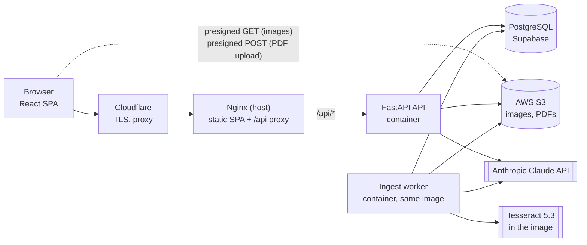

# Architecture

System overview, code map and the conventions every feature follows. Feature behaviour lives in
[`features/`](./features); the schema in [DATA_MODEL.md](./DATA_MODEL.md); hosting in
[DEPLOYMENT.md](./DEPLOYMENT.md).

**Code:** `app/main.py`, `app/deps.py`, `app/worker/`, `ingestion/`, `frontend/src/App.jsx`

## System

| Component | Responsibility |
|---|---|
| **React SPA** | All UI. Built by CI, served as static files by Nginx; calls the API at same-origin `/api/*`. |
| **Nginx** | Origin TLS (Cloudflare Origin Certificate), serves the SPA with `index.html` fallback, proxies `/api/` to the API on loopback. 100 MB request bodies, 300 s proxy read timeout. |
| **FastAPI API** | Every HTTP endpoint: auth, browse, generation (PDF rendered in-process), reference data, manual import, papers editor, auto-import job control and review. Single uvicorn process. |
| **Ingest worker** | `python -m app.worker`: drains the ingest-task queue in Postgres one task at a time, runs the `ingestion/` pipeline over uploaded booklets, writes review images to S3 and a proposal to the job row. Also runs the daily sweep and reconciler. See [features/auto-import.md](./features/auto-import.md). |
| **PostgreSQL** | All metadata, the ingest job/task queue, audit events, worker heartbeat. No images. |
| **S3** | Question page images, temporary uploads, auto-import source PDFs and review pages. Never public: the browser reaches objects only through presigned URLs. |
| **Claude API** | Paper metadata extraction, part split + topic/marks labelling (API), booklet segmentation (worker). |
| **Tesseract** | OCR of scanned answer tables (worker only). |
| **`ingestion/` library** | Booklet → proposal: segment, split, locate questions, read answer tables. Installed into the image; never imports `app`. See [features/ingestion-pipeline.md](./features/ingestion-pipeline.md). |

## Code map

### Backend (`app/`)

| Path | What it holds |
|---|---|
| `app/main.py` | App setup: router registration, `/api/health`, request-id middleware, DB-unavailable handler |
| `app/routes/` | HTTP endpoints only, one module per area: `auth`, `users`, `reference`, `questions`, `generate`, `generation_config`, `site_config`, `ingest` (manual + auto import), `papers` (papers editor) |
| `app/services/` | Business logic shared by routes: auth/OAuth, premium policy, question query + serialization, question parts, paper selection, generation config, site config + About sanitizer, manual import, paper edits, ingest jobs/review/confirm/matching/answer mapping/events |
| `app/schemas/` | Pydantic request/response models |
| `app/models/orm.py` | SQLAlchemy models for every table |
| `app/db.py`, `app/deps.py` | DB engine/session; injectable outbound I/O (S3, Claude, pipeline runner) |
| `app/storage/` | S3 client and the object-store interface used by auto-import |
| `app/ai/` | Claude clients: paper metadata extraction, question labeller, per-job cost accounting |
| `app/pdf/` | PDF → image + image standardisation, layout engine, rich-text renderer, synthetic sample data |
| `app/worker/` | Ingest worker: main loop + heartbeat, Postgres task store, S3/DB hooks around pipeline stages, daily sweep, reconciler |
| `app/logging_setup.py`, `app/log_context.py`, `app/logger.py`, `app/middleware.py` | JSON logging, context fields, timing/token/cost helpers, `X-Request-ID` |
| `alembic/versions/` | Migrations; the initial one also seeds reference data and an admin account |

### Ingestion library (`ingestion/`)

| Path | What it holds |
|---|---|
| `ingestion/pipeline/` | Stage runner: job of tasks in a store (SQLite locally, Postgres in the worker) |
| `ingestion/ingester/` | Booklet level: Claude segmentation, split into one PDF per paper |
| `ingestion/question_extractor/` | Inside one paper: question rectangles, answer-table reading, OCR |
| `ingestion/samples/` | Regression corpus for sample-diff verification |
| `ingestion/docker/tesseract/` | Local Tesseract image (`docker compose build tesseract`) |

### Frontend (`frontend/src/`)

| Path | What it holds |
|---|---|
| `App.jsx` | Routes and role guards; mounts `AuthContext`, `SiteConfigContext` and the upload queue |
| `api/client.js` | Fetch wrapper, friendly error messages, presigned S3 upload, per-resource API calls |
| `components/` | Shared UI: app shell + menubar, user menu, parts editor, tag combobox, protected image, About-page rich editor, dialogs |
| `components/browse/` | Filter bar, topic multi-select, question card, question detail modal |
| `components/generate/` | PDF-safe rich-text editor |
| `context/` | `AuthContext` (session), `SiteConfigContext` (public site settings) |
| `features/import/` | Auto import, upload queue, review queue, review page, pairing/matching UI, manual import wizard |
| `features/papers/` | Papers list and paper editor |
| `features/reference/` | Reference data tabs and modals |
| `features/users/` | User list and invite modal |
| `hooks/useQuestionSearch.js` | Filtered, paginated question list shared by Browse and Generate |
| `pages/`, `pages/admin/` | Route-level pages |
| `utils/` | Topic formatting, premium checks, user display name, PDF filename |

### Other

| Path | What it holds |
|---|---|
| `scripts/` | `generate_sample_pdf.py` and `pdf_to_images.py` (PDF visual checks, see [TESTING.md](./TESTING.md)); `import_topics.py` (bulk topic import from a text file; imports a missing `app.config` module and does not run as is) |
| `tests/` | Backend pytest suite; `tests/integration/` needs live credentials |
| `deploy/` | Production compose, Nginx site, backup script, systemd timer, env template |
| `Dockerfile`, `docker-compose.yml` | Production image (API + worker); local MinIO and the Tesseract tool image |
| `.github/workflows/` | `ci.yml` (PRs and branches), `deploy.yml` (push to `main`) |

## Pages

All pages except `/login` and `/register` render inside the app shell (role-aware menubar). Unknown
paths redirect to `/`.

| Path | Page | Access | Doc |
|---|---|---|---|
| `/login`, `/register` | Sign in / register | Public | [auth](./features/auth.md) |
| `/` | Browse questions | Public | [browse](./features/browse.md) |
| `/about` | About page (admins edit in place) | Public | [site-config](./features/site-config.md) |
| `/generate` | Generate a paper | Signed in | [paper-generation](./features/paper-generation.md) |
| `/subscribe` | Premium plans (payment stub) | Signed in | [users-and-premium](./features/users-and-premium.md) |
| `/admin/import` | Redirects to Manual import if one is in progress, else Auto import | Admin | [auto-import](./features/auto-import.md) |
| `/admin/import/auto` | Drop PDFs, upload queue, processing board | Admin | [auto-import](./features/auto-import.md) |
| `/admin/import/review` | Review queue | Admin | [auto-import](./features/auto-import.md) |
| `/admin/import/jobs/:jobId/review` | Review one job's proposal | Admin | [auto-import](./features/auto-import.md), [qa-pairing](./features/qa-pairing.md) |
| `/admin/import/manual` | Manual import wizard | Admin | [manual-import](./features/manual-import.md) |
| `/admin/papers`, `/admin/papers/:id` | Papers list, paper editor | Admin | [manage-papers](./features/manage-papers.md) |
| `/admin/reference` | Reference data | Admin | [reference-data](./features/reference-data.md) |
| `/admin/users` | Users, invites, premium, site settings | Admin | [users-and-premium](./features/users-and-premium.md) |
| `/admin/generation-config` | Generation presets and cover titles | Admin | [generation-config](./features/generation-config.md) |

- Signed-out visitors on a signed-in page, and non-admins on an admin page, are sent to `/login`.
- Menubar: Question Bank, Generate Paper, About for everyone; admins also get Reference, Import,
  Papers, User Management, Generation Config; Normal users get a **Go Premium** link to
  `/subscribe`. Signed-in users get an account menu with **Log out** (returns to `/`); signed-out
  visitors get **Log in**.
- A question opens in a modal over Browse or Generate; there is no question URL.

## Conventions

**Access control**
- The backend enforces every rule; frontend guards only route the user. Each endpoint is one of:
  public (reference data reads, question browse, site config read, auth), signed in (generation,
  generation config read, cover titles) or admin (all writes to reference data, papers, users,
  config, and everything under import).
- Session: JWT in an httpOnly, Secure, SameSite=Lax cookie, valid 7 days. See
  [features/auth.md](./features/auth.md).
- Any `401` outside the login call clears the session in the UI.

**Images**
- Images reach the browser only as presigned S3 URLs inside API responses (1 h by default); the
  API never streams an image. The premium paywall works by withholding the URL — see
  [features/users-and-premium.md](./features/users-and-premium.md).
- The `protect_images` setting is a client-side deterrent only; the URL is still in the response.
- Auto-import PDFs go straight from the browser to S3 (presigned POST, ≤ 100 MB); the API never
  receives them. This is the only cross-origin request, so only the bucket needs CORS.

**Storage consistency**
- New images are written to a temporary key, copied to their final key, the DB is committed, and
  only then are the temporary objects deleted — a failure leaves the upload retryable.
- Deletions commit the DB first, then delete objects (S3 deletes are irreversible); an orphaned
  object is reported (and, once enabled, deleted) by the daily reconciler, never a dangling DB row.

**Errors**
- Database unreachable → the API answers "Database is temporarily unavailable — please retry"
  (503).
- The frontend turns error statuses into short messages (session expired, admin access required,
  name already exists / still in use, invalid input, server error), preferring the server's own
  message where it gives one.

**Logging and request ids**
- API and worker log one JSON object per line to stdout; no log files.
- Every record carries `request_id`, `user_id`, `job_id`, `section`, `stage` when known, so one
  `grep` on a job id finds its lines across both containers.
- Every response carries `X-Request-ID` (a valid supplied one is echoed, else generated).
- Claude calls log model, tokens and cost. See [DEPLOYMENT.md](./DEPLOYMENT.md#observability).

**Code boundaries**
- Route modules hold routes only; anything a second module needs lives in `app/services/`.
- Outbound I/O (S3, Claude, the worker's pipeline runner) reaches routes through `app/deps.py`, so
  tests replace it with fakes through dependency overrides.
- `ingestion/` never imports `app` (a test enforces it); the worker adapts it to Postgres and S3.

**Domain display**
- A question's marks are the sum of its parts' marks; there is no question-level marks field.
- Topics always display as `T{n}: Name` (e.g. "T1: Algebra"); keyword search matches the `T{n}`
  token too.
- Two rich-text editors: the PDF-safe one (bold, italic, underline, link) for generation presets
  and cover bodies, and a full one (headings, lists, colour, size) for the About page. Widening the
  first would let admins author markup the PDF silently drops.
