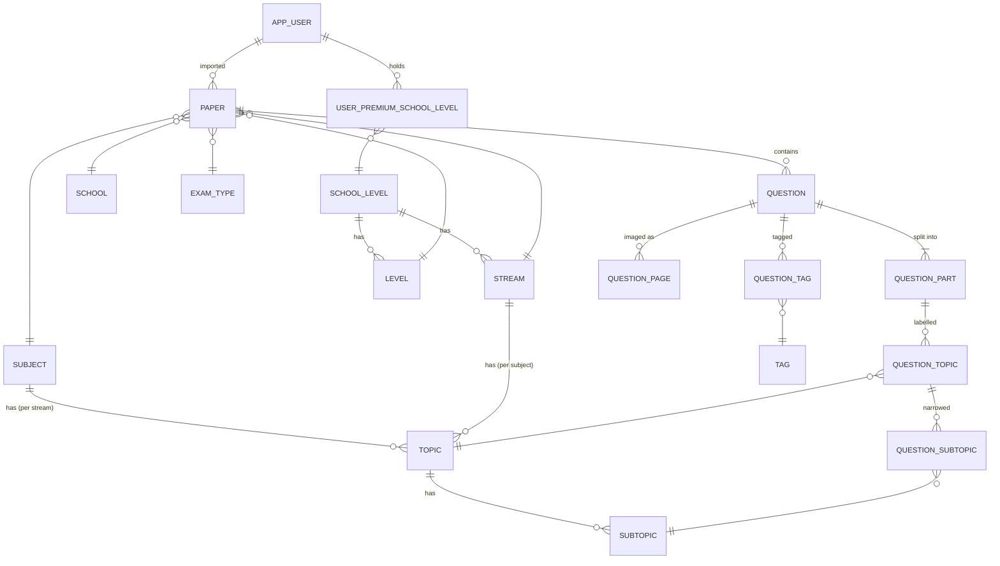
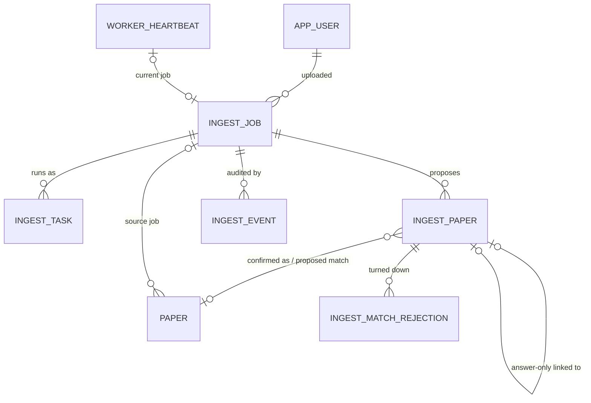

# Data Model

The schema at entity level, plus object-store layout and image conventions. How each table is read
and written is in the owning feature doc.

**Code:** `app/models/orm.py`, `alembic/versions/`, `app/storage/`, `app/pdf/image_processing.py`

## Question bank

### Reference data

Admin-maintained lists; see [features/reference-data.md](./features/reference-data.md). The initial
migration seeds school levels, subjects, streams, levels and exam types.

- **school_level** — Primary, Secondary, …; the unit premium is sold in.
- **stream** — e.g. G1, G2, G3; belongs to one school level; names unique across all streams.
- **level** — e.g. Sec 1; belongs to one school level; has a display `sort_order`; name unique within
  its school level (the same name may exist under Primary and Secondary).
- **subject**, **school**, **exam_type** — plain unique names.
- **topic** — belongs to a (subject, stream) pair, so each stream has its own topic list per
  subject; has a `topic_number`. Name and number are each unique within the pair.
- **subtopic** — belongs to a topic; name unique within it. Deleting a topic deletes its subtopics.
- **tag** — free-form question tags; unique names.
- Deleting reference data that a paper, stream, level, topic or labelled part still uses is
  refused. Exceptions: deleting a subtopic or tag removes it from the questions that carry it.

### Papers and questions

- **paper** — one exam paper, identified by subject, stream, level, school, exam type, year and
  `paper_number` (short text: "1", "2", "a"). No uniqueness is enforced on that key.
  - `is_premium` — gated behind premium for its school level.
  - The paper's school level is its **level's** school level; writes reject a paper whose stream
    belongs to a different school level.
  - `created_by` — the importing admin; such a user cannot be deleted.
  - `source_job_id` — the auto-import job that created it (null for manual imports).
  - Deleting a paper deletes its questions, parts, pages and labels.
- **question** — one numbered question in a paper (`question_number`).
  - Provenance for auto-imported questions: `section` (the proposal paper's label) and
    `proposal_question_index`; null for manual imports.
- **question_part** — the labelling unit; see [below](#questions-have-parts).
  - `part_order` (0-based, unique per question), `label` as printed (`"(a)(i)"`, or `""`),
    `marks` (nullable).
- **question_page** — one stored image of a question.
  - `page_type` `question` or `answer`, `page_order` (unique per question and type), `image_key`,
    `width_px` / `height_px` (positive; used by the PDF layout engine).
  - Provenance for auto-imported pages: `source_page` (booklet page) and `source_rect` (crop
    rectangle in PDF points); null for manual imports.
- **question_topic** — a topic on a part.
- **question_subtopic** — a subtopic on a part; the database only accepts it when the part already
  has the subtopic's topic, and removing that topic removes the subtopic.
- **question_tag** — tags apply to the whole question, not to parts.

### Questions have parts

- Every question has at least one part; an unparted question has one part labelled `""`. Enforced
  in code, not by the database.
- Topics, subtopics and marks hang off parts, never off the question.
- `label` is the paper's own text: `(a)(i)`, `(a)(ii)` and `(b)` are three independent parts, so a
  label cannot be derived from position.
- A question's marks total is the sum of its parts' marks, computed on read, never stored; it is
  null when no part has marks (generation treats that as "unmarked").
- Images are never split per part; one set of pages covers all parts. The split is a labelling
  concern — see [features/ai-labelling.md](./features/ai-labelling.md).
- Relabelling a question replaces all its parts; their topic and subtopic rows go with them.

### Users and premium

See [features/auth.md](./features/auth.md) and
[features/users-and-premium.md](./features/users-and-premium.md).

- **app_user** — one account.
  - `email` unique, always stored lower-cased (only case and surrounding whitespace fold; Gmail dots
    and `+` aliases do not).
  - `first_name`, `last_name` — empty string when unknown; the UI then shows the email.
  - `role` — `admin` or `public` (shown as "Normal"); a check constraint allows nothing else.
  - `password_hash`, `google_sub` — both nullable; together they give four states:

    | `password_hash` | `google_sub` | Account |
    |---|---|---|
    | set | null | Registered with a password |
    | null | set | Created by signing in with Google |
    | set | set | Password account later linked to Google |
    | null | null | Admin-created invite, not yet claimed (cannot sign in) |

  - `last_login_at` — stamped on every successful sign-in; null if never signed in.
  - `papers_generated` — running count of generated PDFs.
- **user_premium_school_level** — one row per school level a user has paid for. "Is premium" is
  derived from these rows, never stored. Deleting the user or the school level removes the grant.
- The initial migration seeds one admin account, `admin@pillora.com`.

### Configuration singletons

Each table holds exactly one row (`id = 1`, enforced by a check constraint).

- **generation_config** — presets for non-admin paper generation: two subtitle placeholders, and
  rich-text `cover_body`, `header_text`, `additional_instructions`, `footer_text` (PDF-safe HTML
  subset, sanitised when rendered). See [features/generation-config.md](./features/generation-config.md).
- **cover_title** — the list of cover titles non-admins must choose from (unique names; seeded with
  "Topical Worksheets").
- **site_config** — `about_content` (rich-text HTML for `/about`, sanitised on write) and
  `protect_images` (default off). Separate from generation config because both fields must reach
  signed-out visitors. See [features/site-config.md](./features/site-config.md).

## Auto-import

See [features/auto-import.md](./features/auto-import.md) and
[features/qa-pairing.md](./features/qa-pairing.md).

- **ingest_job** — one uploaded booklet PDF.
  - `status`: `awaiting_upload`, `queued`, `running`, `review_ready`, `failed`, `confirmed`,
    `cancelled`, `expired` (`expired` appears only on old rows).
  - `filename`, `source_key` (S3 key of the PDF), `sha256` and `page_count` (null until the worker
    has read the PDF).
  - `proposal` — the pipeline's proposed papers/questions/pages; `proposal_edited` — the admin's
    edits. Together the source of truth for a paper's contents during review.
  - `report` — run summary: metadata read from each paper's cover, `review_outcome` per paper
    (`confirmed` / `skipped` / `attached`; the job is `confirmed` once every paper has one), and the
    job's Claude `cost`.
  - `debug` — the segmentation and ingest reports, kept after the worker's scratch folder is gone.
  - `confirmed_paper_ids` — papers this job created or added answers to, in order.
  - `error`; `created_by` (a user with jobs cannot be deleted).
- **ingest_task** — one stage of a job, optionally per section (`register`, `segment`, `split`,
  then per-section stages, then `report`).
  - `status`: `pending`, `ready`, `running`, `done`, `skipped`, `failed`, `blocked`.
  - `attempts`, `reason`, `error`, last ~4 KB of `traceback`, `warnings`, `needs_review`,
    `fingerprint` (for resuming), lease and timing columns.
  - One task per (job, section, stage), including job-level tasks with no section.
- **ingest_paper** — one paper a job proposed: the queryable mirror of the per-paper parts of
  `proposal` and `report`, used for matching across jobs.
  - `paper_key` (unique per job: `q1`, `a1` or `paperN`), `role` (`question` / `answer_only`).
  - The seven identifying fields (nullable until known), plus `new_school_name` for a school typed
    during review that is not in the list yet (created on confirm).
  - `metadata_source`: `cover`, `filename` or `admin`.
  - `status`: `pending`, `confirmed`, `skipped`, `attached`; `paper_id` once confirmed.
  - Pairing: `matched_ingest_paper_id` (answer-only ↔ pending question paper, both rows point at
    each other), `answer_map` (answer label → question label; null means by question number;
    cleared when the link changes).
  - Matching to the bank: `match_status` (`proposed`, `manual`, `auto`, or null),
    `proposed_paper_id`, `match_note` (why manual).
- **ingest_match_rejection** — a pairing the admin turned down, against either a pending paper
  (counts in both directions) or a bank paper; automatic matching never proposes it again.
- **ingest_event** — append-only audit trail, never pruned: job created, task claimed/finished,
  retry, cancel, proposal edited, paper confirmed/skipped/attached/deleted, reconciler findings.
  Holds the actor (null for the worker) and details.
- **worker_heartbeat** — single row the worker updates: last seen, version, current job, last daily
  sweep.

## Object store

One private S3 bucket per environment (`S3_BUCKET`).

| Prefix | Contents | Lifetime |
|---|---|---|
| `papers/{paper_id}/q{question_number}/` | Stored question images: `{page_type}_{page_order}.webp` on import; replacements from the paper editor get a random suffix instead of the order | Until the question or paper is deleted |
| `tmp/{upload_id}/` | Manual-import page images, confirm crops, paper-editor replacement images before they are saved | Moved to `papers/` on save; bucket rule expires the rest after 2 days |
| `ingest/{job_id}/` | Auto-import `source.pdf` and review `pages/` | Deleted when the job settles or is cancelled; no expiry rule |
| `tmp/ingest/{job_id}/` | Same, for older jobs | Readers derive a job's prefix from its stored source key |

Database backups go to a separate bucket — see [DEPLOYMENT.md](./DEPLOYMENT.md#backups).

## Image conventions

- Stored as WebP, quality 85.
- PDF pages are rendered at 300 dpi; auto-import crops are taken at 300 dpi from the booklet.
- Images are stored content-only: no margins, no question number (the PDF engine adds both).
- Width is capped at 1760 px (wider images are downscaled, aspect kept; narrower ones are never
  upscaled). Height varies; nothing is resized to A4.
- Actual `width_px` / `height_px` are stored with each page so layout needs no image reads.
- In generated PDFs, question images are scaled to exactly 1760 px and centred on a 2480 px page;
  answer images keep their stored width, flush to a 360 px left margin. See
  [features/pdf-rendering.md](./features/pdf-rendering.md).
- Images sent to Claude are downscaled copies (long side ≤ 768 px); the stored image is unchanged.
