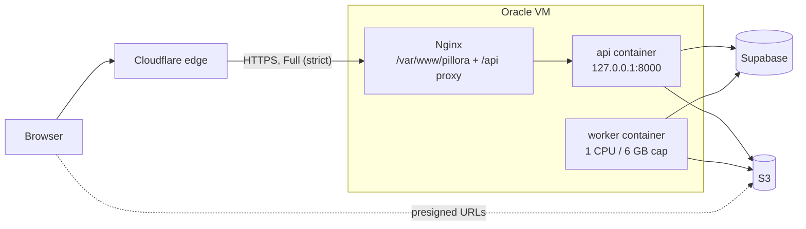

# Deployment

Hosting, environments, CI/CD, configuration, one-time provisioning, backups, rollback and
observability.

**Code:** `Dockerfile`, `deploy/docker-compose.prod.yml`, `deploy/nginx/pillora.conf`,
`deploy/scripts/backup_db.sh`, `deploy/systemd/`, `deploy/journald/`, `deploy/pillora.env.example`,
`.github/workflows/ci.yml`, `.github/workflows/deploy.yml`

## Hosting

| Component | Service | Notes |
|---|---|---|
| App server | Oracle Cloud always-free Ampere VM (`VM.Standard.A1.Flex`) | **arm64**, 2 OCPU / 12 GB, Ubuntu 24.04. Host Nginx + Docker (API and worker containers) |
| Database | Supabase managed Postgres, free tier | 500 MB (metadata only; expected < 50 MB). **No managed backups or PITR** — see [Backups](#backups). Kept off the VM so a VM loss loses no data |
| Object storage | AWS S3, `ap-southeast-1` | Images bucket + backups bucket, both private and versioned |
| Registry | GitHub Container Registry | `ghcr.io/billyhoce/pillora-api`, `linux/arm64` |
| Edge | Cloudflare (proxied DNS, free) | Browser TLS, DDoS protection, hides the origin IP |
| Origin TLS | Cloudflare Origin Certificate | 15-year cert on Nginx, SSL mode Full (strict); no ACME renewal |
| Domain | `questionbank.pillora.com.sg` | `www.pillora.com.sg` stays on Wix, DNS-only, untouched |
| AI | Anthropic Claude API | Haiku 4.5 for labelling, metadata and segmentation; segmentation retries on Opus 5 |



- The API and worker run the **same image**: Python 3.11 on Debian bookworm with `tesseract-ocr`
  5.3.0 (the version OCR calibration assumes) and the `ingestion/` package installed.
- `api`: uvicorn, single process, bound to loopback; Docker healthcheck on `/api/health` every 30 s.
- `worker`: `python -m app.worker`, no ports, capped at 1 CPU / 6 GB (an 80-page booklet fits),
  leaving the other core and 6 GB to the API, Nginx and the OS. Check with `docker stats` after a
  large booklet.
- Both restart `unless-stopped`, read `/opt/pillora/.env` and log to the host's journald (see
  [Observability](#observability)).
- Same-origin SPA and API, so the API needs no CORS. The only cross-origin request is the browser's
  direct PDF upload to S3, which needs the bucket CORS rule (provisioning step 6).

## Environments

| Env | Database | Object store | URL |
|---|---|---|---|
| Local | Dev Supabase project | MinIO (`docker compose up`) or a dev S3 bucket | `http://localhost:5173` |
| Production | Supabase production project | `pillora-question-bank-prod` | `https://questionbank.pillora.com.sg` |

There is no staging environment: PR review, green CI and fast rollback cover it.

Locally the worker runs either on the host (`python -m app.worker`) or in the production image via
the opt-in compose profile (`docker compose --profile worker up -d --build`); see the README.

## CI (pull requests and non-`main` branches)

`.github/workflows/ci.yml`, two parallel jobs:

- **backend-tests** — Python 3.11: `pip install -r requirements-dev.txt`, then
  `pytest tests/ --ignore=tests/integration` (offline: SQLite + moto).
- **frontend-build** — Node 22: `npm ci`, `npm run lint` (informational, never fails the job),
  `npm test` (Vitest), `npm run build`.

Details of the suites: [TESTING.md](./TESTING.md).

## CD (push to `main`)

Every push to `main` deploys to production. `.github/workflows/deploy.yml`; deploys never run
concurrently.

1. **test** — backend pytest only (frontend tests and lint are not part of the deploy gate).
2. **build-and-push** — cross-builds the image for `linux/arm64` (QEMU) and pushes
   `pillora-api:<sha>` and `:latest`; builds the frontend and uploads `dist/`.
3. **deploy** (SSH to the VM, aborts on any failed step):
   1. Replace `/var/www/pillora` with the new `dist/`.
   2. Reset `/opt/pillora/repo` to `origin/main`; refresh `/opt/pillora/backup_db.sh`.
   3. Pull the new image (`IMAGE_TAG=<sha>`).
   4. **Dump the database to S3** — failure aborts before migrating.
   5. `alembic upgrade head` in a one-off API container.
   6. `docker compose up -d` (API and worker).
   7. Poll `/api/health` for ~30 s; fail the deploy if it never answers.

- The frontend is swapped **before** migrations and the health check, so a failed deploy can leave
  the new SPA in front of the old API.
- Migrations run on every deploy and also seed data; there is no separate seed step.

### GitHub secrets

| Secret | Purpose |
|---|---|
| `DEPLOY_HOST` | VM public IP or DNS name |
| `DEPLOY_USER` | SSH user on the VM |
| `DEPLOY_SSH_KEY` | Private key whose public half is in that user's `authorized_keys` |

GHCR uses the built-in `GITHUB_TOKEN`. **App secrets never go to GitHub**: they live only in
`/opt/pillora/.env` on the VM (mode `0600`), and migrations run there.

## Configuration

Production values live in `/opt/pillora/.env` (template `deploy/pillora.env.example`); local values
in the gitignored `.env` (template `.env.example`). Both containers and the backup script read it.

| Variable | Used by | Purpose |
|---|---|---|
| `DATABASE_URL` | API, worker, backups | Postgres URL with the `+psycopg` driver; Supabase **session pooler, port 5432** (Alembic needs it) |
| `JWT_SECRET_KEY` | API | Signs session tokens. Long random value (`openssl rand -hex 32`); the code falls back to an insecure default if unset |
| `S3_BUCKET` | API, worker | Images bucket |
| `AWS_ACCESS_KEY_ID`, `AWS_SECRET_ACCESS_KEY`, `AWS_DEFAULT_REGION` | API, worker, backups | S3 credentials and region |
| `S3_ENDPOINT_URL` | API, worker | Local MinIO only (`http://localhost:9000`); **unset in production** |
| `BACKUP_S3_BUCKET` | Backups | Bucket for database dumps |
| `ANTHROPIC_API_KEY` | API, worker | Claude API |
| `GOOGLE_CLIENT_ID`, `GOOGLE_CLIENT_SECRET`, `GOOGLE_REDIRECT_URI` | API | Google sign-in. Optional: leave unset and the Google button is hidden. Redirect URI must match the OAuth client exactly |
| `INGEST_OCR_COMMAND` | Worker | Tesseract command. `tesseract` in production; unset runs the local `pillora-tesseract` Docker image |
| `INGEST_SCRATCH_DIR` | Worker | Per-job working folder, default `/tmp/ingest` |
| `INGEST_RECONCILE_DELETE` | Worker | Default off: the daily reconciler only reports orphans and stuck jobs. `true` lets it delete orphans, cancel abandoned uploads and fail stuck jobs. Turn on once its reports look right |
| `INGEST_SEGMENT_MODEL`, `INGEST_RETRY_MODEL` | Worker | Override the segmentation model (`claude-haiku-4-5`) and its retry model (`claude-opus-5`) |
| `INGEST_FIXTURES_DIR` | Worker | Development only: segmentation plans used instead of calling Claude |
| `WORKER_VERSION` | Worker | Recorded on the worker heartbeat |
| `LOG_LEVEL` | API, worker | Root log level, default `INFO` |

## One-time VM provisioning

1. **VM** — `VM.Standard.A1.Flex`, 2 OCPU / 12 GB, Ubuntu 24.04 aarch64. Open port **443** only,
   ideally restricted to [Cloudflare's IP ranges](https://www.cloudflare.com/ips/). Keep 80 closed.
2. **Host packages:**
   ```bash
   sudo apt update
   sudo apt install -y docker.io docker-compose-v2 nginx postgresql-client git curl unzip
   sudo usermod -aG docker,systemd-journal "$USER"   # log out and in again; journal = read logs
   ```
   AWS CLI v2 (not available via apt):
   ```bash
   curl "https://awscli.amazonaws.com/awscli-exe-linux-aarch64.zip" -o awscliv2.zip
   unzip awscliv2.zip && sudo ./aws/install && rm -rf aws awscliv2.zip
   ```
   Tesseract and PDF libraries live in the image, not on the host.
3. **Repo** (the deploy job syncs the compose file and backup script from it):
   ```bash
   sudo mkdir -p /opt/pillora && sudo chown "$USER":"$USER" /opt/pillora
   git clone https://github.com/billyhoce/PilloraQuestionBank.git /opt/pillora/repo
   ```
4. **Env file and backup script:**
   ```bash
   cp /opt/pillora/repo/deploy/pillora.env.example /opt/pillora/.env   # fill in real values
   chmod 600 /opt/pillora/.env
   cp /opt/pillora/repo/deploy/scripts/backup_db.sh /opt/pillora/backup_db.sh
   chmod +x /opt/pillora/backup_db.sh
   ```
5. **Static dir** owned by the deploy user (the workflow uses no sudo):
   ```bash
   sudo mkdir -p /var/www/pillora && sudo chown -R "$USER":"$USER" /var/www/pillora
   ```
6. **S3** — two buckets in `ap-southeast-1`: `pillora-question-bank-prod` (images) and
   `question-bank-backups` (dumps).
   - Block all public access and enable versioning on both.
   - Lifecycle on the images bucket (this call **replaces** the whole lifecycle config, so keep
     both rules in one file). Never add a rule on `ingest/`: pending auto-import jobs keep their
     files there indefinitely.
     ```bash
     aws s3api put-bucket-lifecycle-configuration --bucket pillora-question-bank-prod \
       --lifecycle-configuration file://lifecycle.json
     ```
     ```json
     {"Rules": [
       {"ID": "expire-noncurrent", "Status": "Enabled", "Filter": {"Prefix": ""},
        "NoncurrentVersionExpiration": {"NoncurrentDays": 30}},
       {"ID": "expire-tmp", "Status": "Enabled", "Filter": {"Prefix": "tmp/"},
        "Expiration": {"Days": 2}, "NoncurrentVersionExpiration": {"NoncurrentDays": 1},
        "AbortIncompleteMultipartUpload": {"DaysAfterInitiation": 2}}
     ]}
     ```
     Add the same noncurrent-version rule (30 days) to the backups bucket.
     Older auto-import jobs may sit under `tmp/ingest/`; settle or cancel them within 2 days of
     applying the `tmp/` rule.
   - CORS on the images bucket, for the browser's direct PDF upload (POST from the app origin
     only):
     ```bash
     aws s3api put-bucket-cors --bucket pillora-question-bank-prod --cors-configuration file://cors.json
     ```
     ```json
     {"CORSRules": [
       {"AllowedOrigins": ["https://questionbank.pillora.com.sg"], "AllowedMethods": ["POST"],
        "AllowedHeaders": ["*"], "MaxAgeSeconds": 3000}
     ]}
     ```
     Without it uploads fail in the browser and jobs stay `awaiting_upload` until cancelled (by the
     admin, or after 1 hour by the reconciler when `INGEST_RECONCILE_DELETE` is on). Locally, MinIO's CORS is set server-wide in
     `docker-compose.yml`.
   - One IAM user: `s3:GetObject`, `s3:PutObject`, `s3:DeleteObject` on the images bucket's
     objects, `s3:ListBucket` on the images bucket (prefix cleanup, reconciler, existence checks),
     and `s3:PutObject` on the backups bucket. Its keys go in `/opt/pillora/.env`.
7. **Cloudflare and Nginx:**
   - Move the `pillora.com.sg` zone to Cloudflare; replicate every existing Wix record and keep
     `www`/root **DNS-only**.
   - Add a **proxied** A record `questionbank` → the VM's IP.
   - SSL/TLS mode **Full (strict)**; enable **Always Use HTTPS**.
   - Create an Origin Certificate for `questionbank.pillora.com.sg` and install it:
     ```bash
     sudo mkdir -p /etc/ssl/cloudflare
     sudo tee /etc/ssl/cloudflare/pillora-origin.pem   # paste certificate, Ctrl-D
     sudo tee /etc/ssl/cloudflare/pillora-origin.key   # paste private key, Ctrl-D
     sudo chmod 600 /etc/ssl/cloudflare/pillora-origin.key
     ```
   - Install the site:
     ```bash
     sudo cp /opt/pillora/repo/deploy/nginx/pillora.conf /etc/nginx/sites-available/pillora.conf
     sudo ln -s /etc/nginx/sites-available/pillora.conf /etc/nginx/sites-enabled/
     sudo rm -f /etc/nginx/sites-enabled/default
     sudo nginx -t && sudo systemctl reload nginx
     ```
   - The site restores real client IPs from `CF-Connecting-IP`; refresh its Cloudflare ranges if
     they change. Optionally enable Authenticated Origin Pulls.
8. **Check DNS** — `dig +short questionbank.pillora.com.sg` returns Cloudflare IPs; `www` still
   serves Wix.
9. **Weekly backup timer:**
   ```bash
   sudo cp /opt/pillora/repo/deploy/systemd/pillora-backup.* /etc/systemd/system/
   sudo systemctl daemon-reload && sudo systemctl enable --now pillora-backup.timer
   ```
10. **Persistent logs** — keep the journal on disk with a 2 GB cap:
    ```bash
    sudo mkdir -p /etc/systemd/journald.conf.d
    sudo cp /opt/pillora/repo/deploy/journald/pillora.conf /etc/systemd/journald.conf.d/
    sudo systemctl restart systemd-journald
    ```
11. **First deploy** — push to `main` (or re-run the workflow). Migrations create the schema and
    seed reference data and an admin account, `admin@pillora.com`. There is no in-app password
    change, so sign in with Google on a real admin address or promote a real account to admin.

## Google OAuth setup

One-time, in the [Google Cloud Console](https://console.cloud.google.com); a free project is
enough.

1. Create a project (e.g. `Pillora Question Bank`).
2. **OAuth consent screen**: External; app name, support and developer emails; authorised domain
   `pillora.com.sg`; scopes `openid`, `userinfo.email`, `userinfo.profile` only (non-sensitive, no
   verification review).
3. **Publish** the app — in "Testing" only listed test users (max 100) can sign in.
4. **Credentials → OAuth client ID → Web application**:
   - Authorised JavaScript origins: leave empty (server-side flow).
   - Authorised redirect URIs, matching `GOOGLE_REDIRECT_URI` exactly:
     - `https://questionbank.pillora.com.sg/api/auth/google/callback`
     - `http://localhost:5173/api/auth/google/callback` (local; Vite proxies `/api`)
5. Put the three `GOOGLE_*` values in `/opt/pillora/.env` and restart the API container. Locally,
   use `.env` with the localhost redirect URI. Nothing goes in GitHub.

Rotating the secret: console, `.env` edit, container restart. No redeploy.

## Backups

- `deploy/scripts/backup_db.sh` streams `pg_dump | gzip` to
  `s3://$BACKUP_S3_BUCKET/db/pillora-<UTC timestamp>.sql.gz`.
  - **Weekly** via `pillora-backup.timer` (runs a missed backup on next boot).
  - **Before every migration** in the deploy; a failed dump aborts the deploy.
  - The bucket is versioned, so an overwritten or deleted dump is recoverable.
- **Restore:**
  ```bash
  aws s3 cp s3://<bucket>/db/<file>.sql.gz - | gunzip | psql "<DATABASE_URL without +psycopg>"
  ```
- **Images:** S3 durability plus versioning; noncurrent versions are kept 30 days.
- **RPO:** up to 7 days for the database (plus a dump at every deploy). Tighten by changing the
  timer's `OnCalendar` to `daily`.

## Rollback

- **Preferred:** `git revert <bad-commit>` and push — a full deploy, frontend included, with a
  fresh dump first.
- **Fast, backend only:** on the VM, from `/opt/pillora/repo/deploy`:
  ```bash
  IMAGE_TAG=<previous-sha> docker compose -f docker-compose.prod.yml up -d
  ```
  Rolls both API and worker. It runs no migrations, so it is safe only if the old code works with
  the current schema. Any later `docker compose up -d` without `IMAGE_TAG` goes back to `:latest`.
- Re-running an old deploy run fails at `alembic upgrade head` once the schema has moved past that
  image (and the frontend has already been swapped by then).
- **Database:** prefer a forward-fix migration over `alembic downgrade`; for data loss, restore the
  latest dump (no PITR).

## Observability

- **Logs:** both containers log one JSON object per line to stdout (`ts`, `level`, `logger`, `msg`,
  `job_id`, `section`, `stage`, `request_id`, `user_id`, `task_attempt`, plus structured fields such
  as `seconds` or `cost_usd`).
  - Docker's `journald` driver hands each line to the **VM's journal**, tagged `pillora-api` or
    `pillora-worker` (migration runs log as `pillora-api` too). The history belongs to the VM, not
    the container, so deploys, rollbacks and restarts keep it (`json-file` logs vanished with every
    recreated container, i.e. every deploy).
  - Retention: the whole journal is capped at 2 GB and survives reboots (`deploy/journald/`,
    provisioning step 10); the oldest lines go first. Check usage with `journalctl --disk-usage`.
  - Nothing is copied off the VM: losing the VM loses its logs. Durable job history is in
    `ingest_event` (below), and the reading commands are under [Reading the logs](#reading-the-logs).

- **Request ids:** every API response carries `X-Request-ID`; quote it to find the request's log
  lines.
- **Health:** `/api/health` (no database hit) — used by the container healthcheck and the deploy.
  An external uptime check (e.g. UptimeRobot every 5 min) is recommended but not part of the repo.
- **Worker liveness:** the worker heartbeats every 30 s; the import pages show "Worker offline" when
  it is more than 90 s stale.
- **Ingest history:** every job's task attempts, admin actions and reconciler findings stay in the
  `ingest_event` audit table and on the job detail panel; each job's Claude cost is on its report.
  See [features/auto-import.md](./features/auto-import.md).
- **Daily reconciler** reports orphaned S3 objects, scratch folders and stuck jobs as log lines and
  audit events.
- Errors to watch: PDF generation failures, Claude call errors, auth failures, database-unavailable
  responses. No error tracker (e.g. Sentry) is wired in.

### Reading the logs

The logs live only on the VM, so reading them **needs SSH** — the same access the deploy uses (a key
in the deploy user's `authorized_keys`; that user must be in `systemd-journal` or `adm`, or use
`sudo`). There is no log viewer in the app or a hosted service.

No interactive session is needed: run `journalctl` over SSH from your machine and filter locally.
`-o cat` prints just the JSON line.

```bash
VM=<user>@<DEPLOY_HOST>

# One auto-import job, both containers, from the last week
ssh $VM "journalctl -t pillora-worker -t pillora-api --since -7d -o cat" | grep <job-id>

# One API request, by the X-Request-ID the user quotes
ssh $VM "journalctl -t pillora-api --since today -o cat" | grep <request-id>

# Follow the worker live; last 200 lines; errors only (pretty-printed with jq)
ssh $VM "journalctl -t pillora-worker -f -o cat"
ssh $VM "journalctl -t pillora-api -n 200 -o cat"
ssh $VM "journalctl -t pillora-worker --since -1d -o cat" | jq -c 'select(.level == "ERROR")'

# Save a day to a file
ssh $VM "journalctl -t pillora-worker --since 2026-10-26 --until 2026-10-27 -o cat" > worker.jsonl
```

- `--since`/`--until` take dates, `today`, `yesterday` or relative times such as `-2h`.
- On the VM, `docker compose -f docker-compose.prod.yml logs -f` (from `/opt/pillora/repo/deploy`)
  also works, but shows only the current containers, i.e. since the last deploy.
