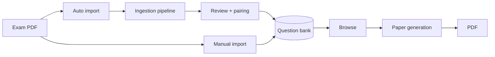

# Documentation

Single source of truth for how the system behaves. One file per capability under `features/`,
each opening with a `Code:` line that names its implementation paths. Local setup is in the root
[README.md](../README.md).

## System

| Doc | Covers |
|---|---|
| [ARCHITECTURE.md](./ARCHITECTURE.md) | Components, system diagram, code map, page routes, cross-cutting conventions |
| [DATA_MODEL.md](./DATA_MODEL.md) | Entities and relationships, S3 key layout, image conventions |
| [GLOSSARY.md](./GLOSSARY.md) | Domain glossary (job, task, stage, section, proposal, link, …) |

## Features

| Doc | Covers |
|---|---|
| [features/auth.md](./features/auth.md) | Register, password and Google sign-in, sessions, page access |
| [features/users-and-premium.md](./features/users-and-premium.md) | Roles, per-school-level premium, paywall, user management — canonical **who can do what** |
| [features/reference-data.md](./features/reference-data.md) | Subjects, streams, levels, schools, exam types, topics, tags — admin CRUD |
| [features/auto-import.md](./features/auto-import.md) | Upload → ingest job → worker → review queue → confirm / skip / attach; retention, logs, cost |
| [features/ingestion-pipeline.md](./features/ingestion-pipeline.md) | The `ingestion/` library: booklet PDF → proposal, stage by stage |
| [features/qa-pairing.md](./features/qa-pairing.md) | Answer-only papers, matching question ↔ answer booklets, attach, linked confirm |
| [features/manual-import.md](./features/manual-import.md) | Manual import wizard |
| [features/manage-papers.md](./features/manage-papers.md) | Editing and deleting stored papers, provenance |
| [features/ai-labelling.md](./features/ai-labelling.md) | Claude part split, topics, marks, paper metadata extraction |
| [features/browse.md](./features/browse.md) | Filtering and search of questions |
| [features/paper-generation.md](./features/paper-generation.md) | Selecting questions and generating PDFs; role rules |
| [features/generation-config.md](./features/generation-config.md) | Admin presets and cover titles that constrain non-admin generation |
| [features/pdf-rendering.md](./features/pdf-rendering.md) | PDF layout rules, page chrome, cover page, rich text |
| [features/site-config.md](./features/site-config.md) | About page editing, image-copy deterrent |

## Operations

| Doc | Covers |
|---|---|
| [TESTING.md](./TESTING.md) | Test suites, PDF visual verification, ingestion sample diffs |
| [DEPLOYMENT.md](./DEPLOYMENT.md) | Hosting, CI/CD, env vars, OAuth setup, backups, rollback, observability |

## Decisions

| ADR | Decision |
|---|---|
| [adr/0001-stage-pipeline.md](./adr/0001-stage-pipeline.md) | Ingest a booklet as a job of file-based stages in a task store |
| [adr/0002-qa-booklet-pairing.md](./adr/0002-qa-booklet-pairing.md) | Pair question and answer booklets by metadata; attach answers to a confirmed paper |
| [adr/0003-ingest-queue-storage-retention.md](./adr/0003-ingest-queue-storage-retention.md) | Postgres queue, direct-to-S3 upload, keep jobs until settled |
| [adr/0004-scored-pending-matching.md](./adr/0004-scored-pending-matching.md) | Score pending question/answer pairs; review a linked pair as one |

`agents/` configures the engineering skills (issue tracker, triage labels, domain docs).
