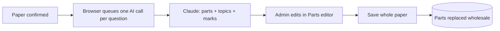

# AI Labelling

Claude (Haiku 4.5) suggests, per question, the split into printed parts with each part's topics and
marks, and per paper, its metadata (school, year, subject, level, stream, exam type, paper number).
Admins review and correct every suggestion before it is saved.

**Code:** `app/ai/`, `app/routes/ingest.py`, `app/services/question_parts.py`,
`app/services/ingest_jobs.py`, `app/worker/edges.py`, `app/pdf/image_processing.py`,
`frontend/src/features/import/TopicReview.jsx`, `frontend/src/components/PartsEditor.jsx`,
`frontend/src/features/import/topicUtils.js`, `frontend/src/features/papers/`
**Related:** [DATA_MODEL.md](../DATA_MODEL.md), [auto-import.md](./auto-import.md),
[manual-import.md](./manual-import.md), [manage-papers.md](./manage-papers.md),
[ingestion-pipeline.md](./ingestion-pipeline.md) (booklet segmentation, the other Claude call)

## Parts, topics and marks

A question is one set of page images; its **parts** — (a), (b), (a)(i) … — exist only as labelling.
Each part has a label, its own marks and its own topics/subtopics. A question's marks total is
**derived** as the sum of its parts' marks, and is empty when no part carries marks.

### When it runs

- **After a paper is confirmed** (manual or auto import), the review step labels every question of
  the paper. An answer-only paper is never confirmed as a paper, so it never reaches this step (its
  answers attach to a question paper — see [qa-pairing.md](./qa-pairing.md)).
- **Manage Papers:** "Re-run AI" on a single question; and when an admin changes a paper's subject or
  stream (after a confirm warning that this clears all topic labels), every question is re-labelled.
  A question whose re-label fails keeps its existing parts on screen.
- Admin-only, **one question per call**. The browser fans out the calls, starting at most one every
  1.3 s. Nothing is saved by the call itself — it only returns a suggestion.

### What the model sees and returns

- Only the question's **question-type pages** (marks are printed on the question paper, not the
  answer key), downscaled to a 768 px long side for the call; stored images are untouched.
- The list of valid topics/subtopics for the paper's **subject + stream**, as short numbered codes
  (`1.1`, `2`). Topics with subtopics offer only their subtopics; topics without offer the bare topic.
  Codes not in the list are discarded, so the model can never invent a topic.
- Rules the prompt enforces:
  - Split exactly as printed, in order; never invent a part.
  - `(a)(i)` and `(a)(ii)` are **separate parts** — (a)(i), (a)(ii), (b) is three parts.
  - A question with no lettered parts is **one part with an empty label**.
  - **Report marks per part; never sum.** A single total printed for the whole question that can't
    be attributed goes on the first part (others empty), so the question's total stays correct and
    it remains selectable for marks-target generation.
- Output is forced into a fixed structure: per part a label, marks (or none) and topic codes.
- Selections are de-duplicated **within** a part only; two parts may test the same subtopic.
- An empty answer becomes one blank part — every question has at least one part.
- The topic list is prompt-cached: all questions of one paper share one subject + stream, so the
  cached list is reused across the paper.

### Failures (retryable per question)

| Situation | Admin sees |
|---|---|
| Response cut off by the output limit (some parts would be missing) | "AI response was cut off — retry". A truncated split is **never** returned as a result. |
| Anthropic rate limit | "rate limited — retry in a moment" |
| Anthropic unavailable / API error | "temporarily unavailable — retry" |

## Review and save

- The review step shows each question's images beside a **Parts editor** pre-filled with the AI
  suggestion, with per-question status (Labeling… / Suggested / error) and a **Re-run AI** / **Retry**
  button. **Confirm & Save Topics** is disabled while any question is still labelling.
- The Parts editor (shared by the import review step and the Manage Papers question editor), per part:
  label, marks, topic/subtopic chips with a picker. Admins can **add and delete parts**; deleting the
  last part leaves one blank part. There is no question-level marks field — a live **Total** shows
  the sum (or "—" when no part has marks).
- Leaving the step:
  - Manual import: **Cancel import** deletes the just-confirmed paper and its pages.
  - Auto-import review: **Skip topics** keeps the paper; topics can be set later in Manage Papers.

### Save rules

- Saving replaces the paper's questions' parts **wholesale**, in on-screen order. The same write
  path backs the import save and the Manage Papers question editor, so their rules are identical.
- Every question must belong to the paper; every topic must belong to the paper's subject + stream;
  every subtopic must sit under its topic.
- All questions are validated **before any is written** — one bad question rejects the save and
  leaves the whole paper's existing labelling intact.
- A question sent with no parts gets one blank part.
- Part labels are capped at **32 characters**; longer is rejected, never truncated.

## Paper metadata extraction

Suggests a paper's school, year, subject, level, stream, exam type and paper number, to pre-fill the
metadata form.

- **Auto import:** after the booklet is segmented, runs **once per paper** in the booklet (each
  question/answer pairing, including answer-only papers). Sends that paper's **cover page(s)** as a
  PDF — or the section's first page when it has no cover — plus the uploaded filename as a hint.
  The review page pre-fills each paper from its own result; older jobs carry a single filename-only
  guess for the whole booklet, used as the fallback.
- **Manual import:** filename only, no cover.
- The model must pick names from the existing reference lists (schools, subjects, levels, streams,
  exam types). Each name is then matched to a reference record by **exact, case-insensitive name**;
  an unmatched field is left blank for the admin.
- **Subjects** are offered with their **code** when they have one ("E Math (code: 4052)"), since a
  cover or filename often names the subject by code; the model still answers with the name, and the
  code is used nowhere else ([reference-data.md](./reference-data.md)).
- **Levels** are offered and matched qualified by school level ("Secondary 4", "Primary 4"), since
  bare level names repeat across school levels; a bare name is accepted only when it names one level.
- **School exception:** a school not in the list is returned **as printed** (e.g. "Raffles Instn").
  It is matched against **school aliases** too: a printed name an admin has already confirmed a paper
  under ("BPGHS" → the school picked then) resolves to that school
  ([qa-pairing.md](./qa-pairing.md#paper-details-and-the-seven-field-key)).
- The **raw names read** (school, subject, level, stream, exam type) are kept beside the matches, so
  the review page can show a school that matched nothing
  ([auto-import.md](./auto-import.md)).
- Any field may be empty when neither cover nor filename says.
- **Never fails the job:** a failed call with a cover is retried on the filename alone; a failure
  there stores empty metadata for that paper.

## Cost

Haiku 4.5: $1 / $5 per million input / output tokens; cache writes 1.25× input, cache reads 0.1×.

| Call | Input | Volume / year | Cost / year |
|---|---|---|---|
| Part split + topic/marks labelling | question image(s) + cached topic list | ~9,600 questions | ~$10 (≈ $0.001 / question) |
| Paper metadata | cover page(s) + filename | ~640 papers | < $1 per 100 papers |

- Every call logs model, token counts, cost and Anthropic request id.
- For ingest jobs the segmentation and per-paper metadata calls are also summed into the job's cost
  ([auto-import.md](./auto-import.md)); question-labelling calls are logged only.
- API key and model configuration: [DEPLOYMENT.md](../DEPLOYMENT.md).
