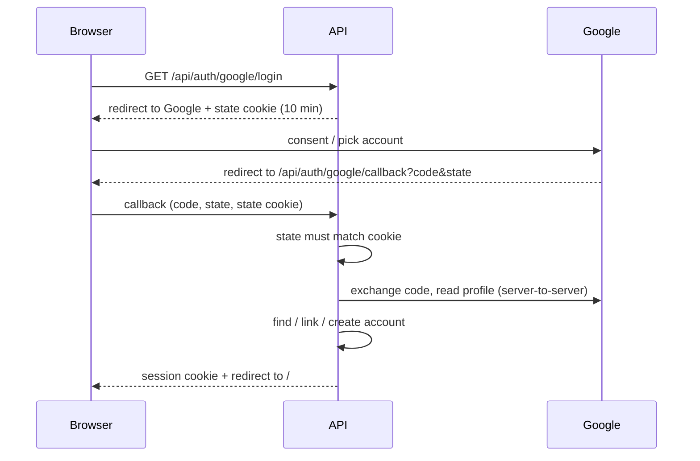

# Auth

Registration, password sign-in, Google sign-in and sessions. Roles, premium and user management are
in [users-and-premium.md](./users-and-premium.md).

**Code:** `app/routes/auth.py`, `app/services/auth.py`, `app/services/google_oauth.py`,
`app/schemas/auth.py`, `frontend/src/context/AuthContext.jsx`, `frontend/src/pages/LoginPage.jsx`,
`frontend/src/pages/RegisterPage.jsx`, `frontend/src/components/GoogleSignInButton.jsx`,
`frontend/src/components/ProtectedRoute.jsx`
**Related:** [users-and-premium.md](./users-and-premium.md), [DATA_MODEL.md](../DATA_MODEL.md),
[DEPLOYMENT.md](../DEPLOYMENT.md) (Google Cloud Console setup, secrets)

## Accounts

- An account has a first name, last name and email, plus any of: a password, a Google link.
- Three ways an account comes to exist:
  - **Register** with email + password (`/register`).
  - **Sign in with Google** on an address with no account.
  - **Pre-added by an admin** with neither credential (an *invite*), so premium is ready before the
    person signs up — see [users-and-premium.md](./users-and-premium.md#pre-adding-a-user).
- Self-registered and Google-created accounts start as role `public` ("Normal") with no premium.
- Every email is stored and looked up **trimmed and lower-cased**, so `Billy@Gmail.com` and
  `billy@gmail.com` are one account. Gmail dot and `+alias` variants are **not** folded (wrong for
  other providers) — they are different addresses.
- No email verification, no password reset, no self-service profile editing.

## Register (password)

1. User fills **First name, Last name, Email, Password, Confirm password** on `/register`.
2. Rules:
   - Names are trimmed; blank or longer than 100 characters is rejected.
   - Password needs ≥ 8 characters, an uppercase letter, a lowercase letter, a digit and a special
     character (enforced server-side; the page shows the rule as hint text).
   - Password and confirmation must match (checked in the browser).
3. Outcome by address:
   - **New address** → account created as Normal.
   - **Unclaimed invite** → the invite is *claimed*: it gets the password, keeps its role and premium,
     and only blank names are filled in.
   - **Address with any credential** → refused ("Email already registered"). Registering can never
     take over an existing account.
4. On success the user is sent to `/login`; registering does not sign them in.

## Sign in (password)

- Unknown email, wrong password and an **unclaimed invite** all give the same generic error
  ("Unknown email or incorrect password").
- An account that has a Google link but **no password** gets a specific message: *"This account was
  created with Google. Use "Sign in with Google" instead."* — deliberate, since the generic error
  would loop the user. It reveals that the address has a Google account; this is the only such
  disclosure.
- An account with both a password and a Google link signs in either way.

## Sign in with Google

Server-side authorization-code flow. The browser never sees the client ID, client secret or any
Google token, and no Google JavaScript is loaded. Scopes are `openid email profile` only. Google's
account picker is always shown.

Account resolution, in order:

1. **Already linked** (same Google account) → sign in. Survives the user changing their Google email.
2. **Same email, not linked** → link the Google account to it and sign in. The account keeps its role
   and premium. This is also how an admin's invite is claimed.
3. **Otherwise** → create a Normal account with no password.

- Names from Google only fill blank first/last names; they never overwrite.
- Google must report the email as **verified**; otherwise sign-in is refused (an unverified address
  would be a route to hijacking an account).
- A different Google address (e.g. a work account) creates a separate account; it does not merge.

Failures land on `/login` with a message:

| Case | Message shown |
|---|---|
| User cancelled / Google refused | Google sign-in was cancelled. |
| State missing or mismatched (expired or forged flow) | That Google sign-in link expired. Please try again. |
| Google email not verified | Your Google email address is not verified. |
| Code exchange or profile read failed | Could not sign in with Google. Please try again. |

- The Google button appears on `/login` ("Sign in with Google") and `/register` ("Sign up with
  Google") only when the deployment has Google configured; otherwise it is hidden.
- The button is a real browser navigation (not an SPA link) so the server can set the state cookie
  and redirect.

## Sessions

- A successful sign-in (either path) sets a **JWT in an httpOnly, secure, SameSite=Lax cookie**,
  valid for **7 days**, and stamps the account's last-login time.
- The token carries only the user id; role and premium are read from the database on every request,
  so admin changes apply immediately. Deleting an account invalidates its session.
- **Log out** (account menu) clears the cookie. Tokens are not revoked server-side.
- The SPA never handles the token. On load it asks the API who is signed in; any 401 from the API
  drops the SPA to signed-out ("Your session has expired. Please log in again.").

## Page access

| Pages | Who |
|---|---|
| `/` (Browse), `/about` | Anyone, signed in or not |
| `/login`, `/register` | Signed-out users; signed-in users are redirected to `/` |
| `/generate`, `/subscribe` | Signed-in users; others go to `/login` |
| `/admin/*` | Admins; others go to `/login` (then `/` if signed in) |

- After sign-in every role lands on `/`.
- The menubar shows the user's full name, falling back to their email when no name is on file.

## Security posture

- Passwords hashed with bcrypt.
- Admin-only API routes refuse non-admins; the same check guards every admin write, import and user
  route. Public read routes accept an optional session so they can tailor responses (e.g. the
  paywall).
- Google flow protected against login CSRF by the state cookie.
- The JWT signing secret falls back to an insecure default and **must** be set in production.
- Not implemented: rate limiting, email verification, CORS (not needed — SPA and API share one
  origin behind Nginx).
- A bootstrap admin account is seeded by the initial database migration.
