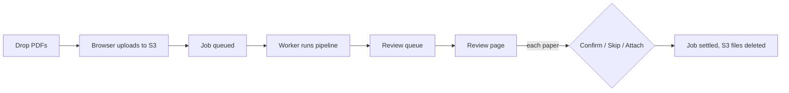
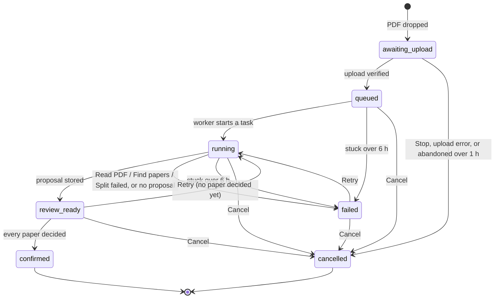

# Auto import

Admins drop whole booklet PDFs; each becomes an **ingest job** that the worker splits into proposed
papers and questions. The admin checks each proposal on a review page and confirms, skips or
attaches every proposed paper.

**Code:** `app/routes/ingest.py`, `app/services/ingest_jobs.py`, `app/services/ingest_review.py`,
`app/services/ingest_confirm.py`, `app/services/ingest_papers.py`, `app/services/ingest_events.py`,
`app/worker/` (`main.py`, `store.py`, `edges.py`, `sweep.py`, `reconcile.py`), `app/ai/job_cost.py`,
`app/storage/`, `frontend/src/features/import/` (`AutoImport.jsx`, `UploadQueue.jsx`,
`PdfDropZone.jsx`, `JobHistory.jsx`, `JobDetail.jsx`, `ReviewQueuePage.jsx`, `ReviewPage.jsx`,
`proposalReducer.js`, `MetadataSidebar.jsx`, `SchoolCombobox.jsx`)
**Related:** [ingestion-pipeline.md](./ingestion-pipeline.md) (what the worker does to a booklet,
stage by stage), [qa-pairing.md](./qa-pairing.md) (answer-only papers, attach, matching),
[manual-import.md](./manual-import.md), [manage-papers.md](./manage-papers.md),
[ai-labelling.md](./ai-labelling.md), [DATA_MODEL.md](../DATA_MODEL.md),
[GLOSSARY.md](../GLOSSARY.md) (job, task, stage, section, proposal),
[ADR 0003](../adr/0003-ingest-queue-storage-retention.md) (why a Postgres queue, direct upload,
keep-until-settled)

## Flow

1. The admin drops PDFs or folders on `/admin/import/auto`. Each PDF becomes its own job.
2. The browser uploads the file straight to S3; the API never holds it. The API then checks the
   object and queues the job.
3. The worker runs the [ingestion pipeline](./ingestion-pipeline.md) over the booklet and stores a
   **proposal**: the papers found, each with its pages and question/answer rectangles.
4. The job appears in the review queue (`/admin/import/review`).
5. On the review page the admin corrects rectangles and metadata, then decides each paper.
6. When every paper is decided the job is **settled** (`confirmed`) and its S3 files are deleted.

## Rules

- All import pages and actions are admin-only. Any admin can see and act on any admin's job.
- Upload size: 1 byte to **100 MB**, content type PDF. The browser's upload permission is valid for
  15 minutes.
- The PDF's content is only checked by the worker. A rejected booklet fails its job with one of:
  "The file is not a readable PDF", "The PDF is password protected", "The PDF has no pages".
- Pending jobs **never expire**. A job stays until every paper is decided or the job is cancelled.
- There is no duplicate detection: the same booklet uploaded twice makes two jobs, and the same
  paper can be confirmed twice.
- A settled job's S3 files are always gone; its database rows (job, tasks, papers, events) are kept
  forever.

## Job statuses

| Status | UI label | Meaning |
|---|---|---|
| `awaiting_upload` | Uploading | Created; the browser has not finished the upload. |
| `queued` | Queued | Uploaded; no task has started. |
| `running` | Running | Some tasks finished or running, others still to run. |
| `review_ready` | Ready for review | Proposal stored. Reached even when some sections failed: they are listed on the review page as not extracted. |
| `failed` | Failed | A booklet-level stage (Read PDF, Find papers, Split) failed, or the run ended with no proposal. The error names the stage, e.g. "register failed: The PDF is password protected". |
| `confirmed` | Confirmed | Settled: every paper confirmed, skipped or attached (even if all were skipped). |
| `cancelled` | Cancelled | Settled: cancelled by an admin, or an upload abandoned for over an hour. |
| `expired` | Expired | Historical rows only; nothing sets it. |

- The worker derives `queued` / `running` / `review_ready` / `failed` from the job's tasks after
  every task. The API alone sets `awaiting_upload`, `confirmed` and `cancelled`, and the worker never
  touches a job in those states.
- Task statuses (job detail): `pending`, `ready`, `running`, `done`, `skipped`, `failed`,
  `blocked`. A task may also be flagged **needs review**.

### Retry

- **Retry** returns the job's failed and blocked tasks, plus everything downstream of them, to the
  queue with their attempt counts reset. Tasks whose inputs are unchanged are not re-run.
- Allowed on `queued`, `running`, `review_ready` and `failed` jobs.
- Refused on `awaiting_upload`, `confirmed`, `cancelled`, `expired`, and on any job with a paper
  already decided (a new proposal would orphan that decision).
- A rejected PDF (see Rules) fails the same way again on Retry.
- Saved review edits are discarded when a Retry produces a different proposal (they were drawn on
  the old one); if the regenerated proposal is identical, the edits are kept.

### Cancel

- Allowed on any job not yet settled, including `review_ready` jobs with some papers already
  confirmed (those papers stay in the bank).
- The status flips to `cancelled` first, then the job's S3 files are deleted. A task already running
  finishes, but its results are dropped and nothing new is uploaded.

## The worker

A second container from the same image (`python -m app.worker`), capped at 1 CPU / 6 GB.
Internals of each stage: [ingestion-pipeline.md](./ingestion-pipeline.md).

- **One task at a time** per worker process. Tasks are claimed **oldest job first**, so booklets are
  processed in upload order: a later booklet waits until the earlier one has nothing left to run.
  Several workers could share the queue safely, but production runs one.
- Only tasks of `queued` / `running` jobs are claimed. An idle worker checks for work every 2 s.
- **Heartbeat:** the worker records it is alive every 30 s. The API reports the worker **offline**
  when that heartbeat is more than **90 s** old (or was never written). The UI then shows "Worker
  offline" on active jobs.
- **Leases:** a claimed task is leased for 10 minutes, renewed by the heartbeat. A task whose lease
  expires (worker crashed or was killed) goes back to the queue; after **3** expired attempts it
  fails and is flagged needs review. A stage that *reports* a failure is never retried automatically.
- **Shutdown:** SIGTERM/SIGINT finish the current task, then exit.
- **On start:** hands back expired tasks, re-derives every unfinished job's status, and re-runs any
  finished task whose working files were lost (e.g. after a redeploy).
- **Around the stages** the worker also:
  - after Read PDF: records the page count and file hash, and queues the booklet-level tasks
  - after Find papers: reads each paper's metadata from its cover with Claude
    ([ai-labelling.md](./ai-labelling.md)); a failed call falls back to the filename, then to blank
    metadata, and never fails the task
  - after Assemble: uploads the review page images, stores the proposal, run summary (timings,
    warnings, needs-review) and a small debug bundle on the job, creates one record per proposed
    paper and runs answer matching ([qa-pairing.md](./qa-pairing.md)); skipped if the job was
    cancelled meanwhile
- **Scratch folder** (local disk, per job) is a cache. It is deleted once Assemble is done; review,
  confirm and "Handle manually" read only S3 and the database. A `failed` job keeps its folder so
  Retry re-runs only what failed.

## Auto import page

`/admin/import/auto`. The import area has three tabs — Auto import, Review queue, Manual import —
showing live counts of uploads in flight and jobs ready for review. `/admin/import` opens Auto
import, or Manual import when one is in progress in this tab.

**Drop zone**
- Drop PDFs or whole folders (walked recursively), or use **Choose files** / **Choose folder**.
- Non-PDFs and macOS `._*` files are ignored and counted. Folder contents queue in path order.
- Never locks: more files can be added while earlier ones upload. A status line says how many were
  added, skipped as duplicates (same name, size and modified time already queued) or ignored.

**Upload queue**
- Each PDF is an entry; at most **3** upload at once, the rest wait.
- Waiting entries: **Remove** (or **Remove N waiting uploads** for all). Uploading: progress bar and
  **Stop** (aborts and cancels the half-made job). Failed: the error, **Retry upload** (a fresh job)
  and **Remove**. Any upload error cancels its job.
- Uploads continue while the admin moves to other pages; leaving the site mid-upload asks first;
  signing out stops them. A finished upload leaves the queue and appears as a job.

**Processing board**
- The upload queue's entries, then every job in `awaiting_upload`, `queued`, `running` or `failed`.
- Counts above it (uploading, queued, running, failed) and a link to the review queue with the
  number of jobs ready.
- Each job row shows:
  - filename (click to open the job detail), page count, warnings, age badge
  - a step tracker — Upload → Read PDF → Find papers → Split → Extract questions → Assemble — green
    behind, blue in progress, red where it failed
  - a caption ("Extract questions · 5/9 tasks", "Waiting for the worker", "Failed at Read PDF"),
    a progress bar while running, and the failure reason
  - "Worker offline" on an active job when the heartbeat is stale; a banner says the same
  - **Retry** (failed jobs) and **Cancel** (asks first)
  - "Upload not finished" for an `awaiting_upload` job started in another tab or session
- **Finished while you were here:** jobs that reached `review_ready` while the page was open, each
  with a Review link; dismissable.
- Polls every 3 s while anything uploads or runs, otherwise every 15 s (so other admins' jobs
  appear). Polling pauses while the tab is hidden and catches up when shown.

**All jobs**
- Every job, settled ones included, newest first: filename, status, failure reason, created time,
  age badge, and **Review** (`review_ready`), **Retry**, **Cancel** where allowed.
- **Age badge** on unsettled jobs: "waiting N days" / "waiting today" since upload; amber after
  **14 days**.
- Filters, combinable: **Awaiting review** (`review_ready` + `failed`), **Unmatched answers** (a
  pending answer-only paper linked to no question paper), and a search box taking a job id (UUID) or
  a numeric paper id (finds the job that created that paper).
- **Job detail:** the job id with **Copy**, and every task with stage, section, status (and needs
  review), duration, warnings, reason or error, plus a collapsible traceback for a failed task.
  Refreshes with the poll.

## Review queue

`/admin/import/review`: every `review_ready` job, **oldest first**. Polled every 10 s, so jobs
appear without a reload; ones that arrive while the page is open are tagged **New**. Failed jobs are
not here; they stay on the Auto import board.

Each card shows:
- filename and **Review**, age badge, page count, papers and how many are still to decide, warnings,
  and "Pages flagged for a closer look" when a task needs review
- one line per proposed paper:
  - Questions / Answers and its key (`q1`, `a1`)
  - its metadata in words (school · year · level · subject · exam type · paper no.), naming the
    missing fields, or "No details read from the cover"; a school typed as new reads "Name (new)"
  - pairing state (answer-only: linked / matching paper found / needs matching / not matched;
    question paper: "Answers linked from another upload") and, for a question paper its own booklet
    only partly answers, "Q5–Q7 have no answers"
  - **Match** on a pending paper that needs a partner, opening the "Match this paper" popup
    ([qa-pairing.md](./qa-pairing.md))
  - decided papers greyed with their outcome
- **Only jobs with unmatched answers** narrows the list.

## Review page

`/admin/import/jobs/:jobId/review`, from the review queue or All jobs. The header links back to the
queue and on to the **next job** (the oldest other one waiting). It opens on the first undecided
paper.

- **Paper tabs** when the booklet holds several papers (`q1 / a1`, or "Answers a1" for an
  answer-only paper), each showing its outcome once decided.
- **Page strip:** thumbnails; a page flagged by the pipeline has an amber border and its reason as a
  tooltip and banner.
- **Page view:** question rectangles in blue, answer rectangles in green, unmatched answers (orphans)
  in grey dashed.
- **Question list:** each question with its number, flags, and "(no answer)" when it has no answer
  box. Clicking one selects it and jumps to its page. Paper warnings sit above it. Unmatched answer
  boxes are counted with "They are not imported."
- **Sections not extracted** (failed or unroutable sections) are listed with reason and page range.
  **Handle manually** cuts that page range out of the booklet into the
  [Manual import](./manual-import.md) wizard, with metadata pre-filled from the job (no new Claude
  call), and switches to it. This is how a booklet whose questions could not be located is finished
  (a scan is located automatically after OCR; it is listed here only when OCR failed).
- A decided paper is read-only.

### Editing

Corrections to the proposal's rectangles and question numbers. Pages, paper labels, the list of
sections not extracted and warnings cannot be changed.

- **Select** a box by clicking it; drag it to move, drag an edge handle to resize. Boxes stay on the
  page and at least 4 pt in each direction.
- The **Selected box** bar names the box, offers **Delete box**, and for an answer box a **Belongs
  to** menu: move it to another question, or to "No question" (an orphan, not imported). An orphan
  can be given to a question the same way. Delete/Backspace deletes; Esc deselects.
- **Draw question box** / **Draw answer box** (answer-only papers have only the latter), then drag on
  the page. One box per press; Esc cancels. Where it goes is shown first:
  - with a question selected: added to that question
  - otherwise a question box starts a new question numbered max + 1; an answer box becomes an orphan
    (in an answer-only paper, a new answer numbered max + 1)
- **Number field:** a duplicate, blank or non-positive number is refused with the reason.
- **Merge with previous:** joins the question into the one above, keeping that one's number.
- **Split before the selected rectangle**, or **split the selected rectangle in half**: the first
  part keeps the number and all answer boxes; the second gets max + 1 and no answers.
- Deleting a question's last question box deletes the question; its answer boxes become orphans.
- **Saving:** edits save automatically 800 ms after the last change and on leaving the page. The
  header shows Saving… / Saved / Not saved (with the reason) and "edited". The generated proposal is
  kept underneath, but there is no "reset to original".
- Edits are accepted only while the job is `review_ready`, and are refused whole if any rule breaks:
  a box off its paper's pages or outside the page, a box with no area, a repeated or non-positive
  question number, or a question with no question box (except in an answer-only paper).

### Metadata sidebar

Shown for question papers (an answer-only paper gets only the Pairing block and **Skip this
paper**).

- Subject, stream, level, school, exam type, year, paper number and **Premium** (ticked by
  default), pre-filled from the metadata read from that paper's cover.
- **School** is a type-to-search box:
  - when the cover named a school that matches none, it is shown in amber as "*Name* — not in the
    list", the closest existing names (by spelling likeness) are listed first, and **Confirm** stays
    disabled with "Pick a school: “Name” is not in the list."
  - its last option is **Use “typed text” as a new school** (not offered when the text equals an
    existing school's name, in any case). The school is created only when the paper is confirmed
    ([qa-pairing.md](./qa-pairing.md)).
- A question paper that would be confirmed partly answered shows "Q5–Q7 have no answers. Add them
  with the answer-box editor, or confirm anyway." Confirm stays enabled.
- A paper that needs or has a partner shows the Pairing block (**Match this paper…**, Unmatch,
  "Not this one"): [qa-pairing.md](./qa-pairing.md).
- Sidebar edits save in the background (800 ms debounce) while the paper is pending, and re-run
  matching. Best effort: Confirm sends the final values anyway.

## Deciding each paper

Every proposed paper ends with one outcome: **confirmed**, **skipped** or **attached**. A paper is
identified by its key: its question label (`q1`), else its answer label (`a1`), else `paper{n}`.

**Confirm** (question papers)
- Needs every metadata field and a school (picked or typed as new). Refused when the job is not
  `review_ready`, the paper is already decided, the stream and level belong to different school
  levels, the paper has no questions (skip it instead), or it is answer-only (attach or skip it).
- Each rectangle of the saved proposal is cropped from the booklet at 300 dpi and standardised like
  any page image ([DATA_MODEL.md](../DATA_MODEL.md)); a scanned page the pipeline straightened is
  rotated by its `straightened_deg` first, so the crop is straight and matches the review image. Question boxes become question pages and answer
  boxes answer pages, in order. **Orphan answers are not imported.**
- The paper, its questions and pages, its provenance ([manage-papers.md](./manage-papers.md#provenance))
  and the paper's outcome commit together; if anything fails nothing is kept. Images reach permanent
  storage before the commit; temporary crops are removed after it.
- A double click cannot create two papers: the second gets an "already confirmed" error.
- A question paper linked to a pending answer-only paper (from this booklet or another) brings that
  paper's answers in too, and records it `attached`
  ([qa-pairing.md](./qa-pairing.md)). The page then says which answers were attached and which
  matched no question.
- Then the [topic review](./ai-labelling.md) step opens on the new paper. **Skip topics (set them
  later in Manage Papers)** keeps the paper.

**Skip**
- Asks first; the paper is not imported. Same job/paper rules as Confirm.
- Skipping a linked paper releases the link; its partner is matched afresh.

**Attach** (answer-only papers): adds the answers to a paper already in the bank. See
[qa-pairing.md](./qa-pairing.md).

**Settling**
- The decision that leaves no paper pending sets the job to `confirmed` and deletes its S3 files.
  Confirming a linked question paper can settle the answer paper's job too.
- After the last decision the page moves to the next job in the queue, or back to the queue.
- A job whose proposal has no papers can only be cancelled.

## Storage and retention

| Where | Holds | Removed |
|---|---|---|
| S3 `ingest/{job_id}/` | Uploaded booklet, review page images | When the job settles or is cancelled. No bucket lifecycle rule. |
| S3 `tmp/ingest/{job_id}/` | Same, for jobs from before the `ingest/` layout | Same. |
| S3 `tmp/…` | Confirm crops, Manual import pages, Manage Papers uploads | After their commit; the bucket expires `tmp/` after 2 days. |
| Worker scratch folder | Pipeline working files | After Assemble, or by the daily sweep. |
| Job record | Proposal, edits, report, cost, debug bundle | Never. |
| Task, paper and event records | State and audit | Never. |

- A job's S3 location is always taken from its stored source key, never rebuilt from its id, so
  older jobs under `tmp/ingest/` keep working.

**Daily sweep** (runs at most once a day across workers and restarts):
1. Deletes scratch folders of jobs cancelled or confirmed more than a day ago.
2. Runs the reconciler.

### Reconciler

Compares the database with S3 and the scratch disk. **Report-only** until
`INGEST_RECONCILE_DELETE=true` ([DEPLOYMENT.md](../DEPLOYMENT.md)); that flag gates every action.

| Check | Finds | Grace | Action when enabled |
|---|---|---|---|
| `orphan_job_prefix` | Job files whose job is missing or settled | 1 day after settling | delete |
| `stale_temp` | Anything under `tmp/` (except `tmp/ingest/`) | 24 h | delete |
| `orphan_scratch` | Scratch folder whose job is missing or not `queued`/`running`/`failed` | 1 day | delete |
| `orphan_paper_image` | Image under `papers/` no question page uses | 7 days | delete |
| `stuck_job` | `queued`/`running` job with no live lease and no activity | 6 h | mark it and its ready/running tasks `failed` ("stuck: …") so Retry works |
| `abandoned_upload` | `awaiting_upload` job | 1 h | cancel it, delete any partial upload |
| `missing_source` | Pending job whose booklet is gone from S3 | — | report only, always |

- Each finding is a WARNING log line and an event (`reconcile`), with its action: `would_delete`,
  `would_mark_failed`, `would_cancel` (dry run); `deleted`, `delete_failed`, `marked_failed`,
  `cancelled` (enabled); `report_only`.
- A failing check is logged and never stops the others.

## Observability

Nothing below is shown in the UI except task details in the job detail; read it from the logs or the
database.

- **Logs:** JSON lines on stdout from both containers. Every line logged while working on a job
  carries its `job_id` (plus section, stage and attempt inside a task); API lines carry a request id.
  Grepping the logs for a job's UUID finds its whole history ([DEPLOYMENT.md](../DEPLOYMENT.md)).
- **Lifecycle lines** (INFO, one each): job created, registered (hash, page count), paper metadata
  read, task claimed / finished (status, duration), proposal stored, scratch released, proposal
  saved, paper confirmed / skipped / attached / deleted, retry, cancelled. Stage failures log at
  ERROR.
- **Tracebacks:** the last 4 KB of a crashed stage's traceback is kept on its task (shown in the job
  detail) until the task is re-run. A failure a stage reports, rather than crashes on, has none.
- **Event history:** one event row per transition, written with the change itself: created, task
  claimed, task finished (including lease-expiry failures), retry, cancelled, proposal edited, paper
  confirmed / skipped / attached / deleted, reconcile (and historical `expired`). Task rows are
  overwritten on re-run; the events keep every attempt.
- **Claude cost:** every Claude call made for a job (segmentation, per-paper metadata) logs its
  request id, model, tokens and USD cost, and adds to a running per-job total (calls, tokens, cache
  writes/hits, cost) kept on the job record. Concurrent calls never lose each other's update.
