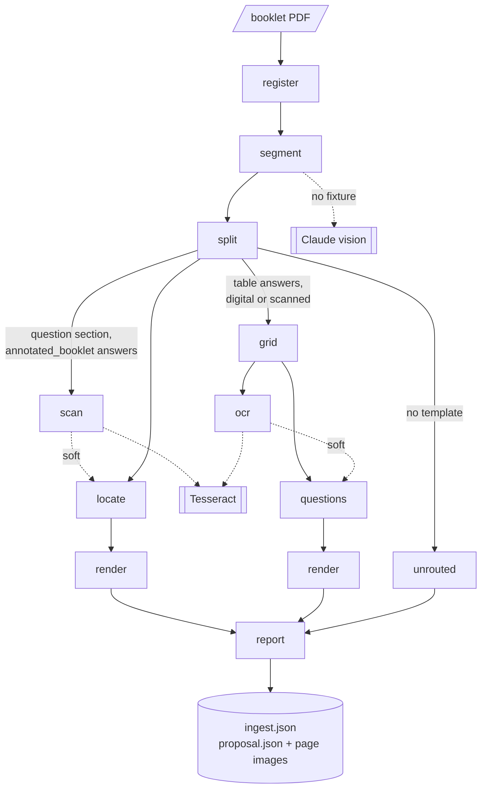

# Ingestion pipeline

Turns one booklet PDF (question papers and their answer papers bound together) into a
**proposal**: every paper in it, each question's rectangles, and every flag an admin should check.
It is the `ingestion/` library; the webapp's ingest worker runs it (see
[auto-import.md](./auto-import.md)), and it also runs from the command line.

**Code:** `ingestion/pipeline/` (runner, registry, store, `stages/`, `proposal.py`),
`ingestion/ingester/` (segment, split, routing), `ingestion/question_extractor/` (locating questions,
answer tables, scans, OCR, renders), `ingestion/docker/tesseract/`
**Related:** [auto-import.md](./auto-import.md), [qa-pairing.md](./qa-pairing.md), [ai-labelling.md](./ai-labelling.md),
[GLOSSARY.md](../GLOSSARY.md), [ADR 0001](../adr/0001-stage-pipeline.md), [ADR 0002](../adr/0002-qa-booklet-pairing.md)

## Flow

A booklet is a **job**; each stage run is a **task** in a store (SQLite locally, Postgres in the
webapp). Stages hand work to each other only through files in the job's folder, so any stage can be
rerun, inspected or hand-edited.



`report` waits until every section task has settled, whichever way it ended.

## Rules

- **Warn, never raise.** A problem becomes a warning and, where a human should look, a
  `needs_review` flag. One section failing never stops the others; one booklet failing never stops
  a folder run or another job.
- A task ends `done`, `skipped` (with a reason) or `failed` (with an error; a crash keeps its
  traceback tail). Downstream of `failed` is `blocked`, of `skipped` is `skipped` — except `locate`
  and `questions`, which only *soft*-need `scan` and `ocr` and run however those ended.
- A job ends `failed` if any task failed or was blocked, else `done` (the webapp maps this onto its
  own job statuses; see [auto-import.md](./auto-import.md)).
- Page numbers are 1-based PDF positions, not printed page numbers. Rectangles are in PDF points; on
  a straightened scan, in the points of the straightened page (same size, rotated about its centre).
- The library never touches the database, S3 or the webapp; matching and attaching answers live in
  the webapp ([qa-pairing.md](./qa-pairing.md)).

## 1. Register

**Code:** `ingestion/pipeline/stages/register.py`

- Records the booklet's sha256, size, page count and the configuration hash.
- Fails if the file is missing or cannot be opened as a PDF.
- Flags `needs_review` early when the PDF is too large to send to Claude (over 100 pages, or over the
  32 MB request limit once base64-encoded) and no segmentation fixture exists; `segment` then fails.

## 2. Segment

**Code:** `ingestion/ingester/segmenter.py`, `segments.py`, `validation.py`, `request.py`, `pipeline/stages/segment.py`

Decides which pages are which and writes the plan (`segments.json`).

- **Reuse first.** A plan already in the job folder, else a committed `<paper>.segments.json` fixture
  beside the PDF, is used without calling Claude (`--force` asks again).
- **Ask, validate, escalate once.** Claude Haiku 4.5 reads the whole PDF; if its answer fails
  validation or the request fails, the retry model (Claude Opus 5 by default) is asked once. An
  invalid answer is rejected whole (overlapping or backwards ranges, bad labels, impossible layouts,
  cover pages inside a range, …).
- **Sections.** `q1`, `q2`, … are question papers; `a1`, `a2`, … answer papers. An answer paper
  takes its question paper's index. Front matter and trailing blanks belong to no section; a blank
  page inside a paper stays in it.
- **Answer templates.** Each answer section is `table` (answers tabulated, no question text) or
  `annotated_booklet` (the question booklet with answers written in). A section Claude is unsure
  about gets no template and is flagged `needs_review`.
- **Table layout.** A `table` section also gets which columns hold question numbers (at most 2
  column groups) and the reading order (`down` or `across`): a hint the table reader checks, not a
  measurement.
- **Cover pages.** Each section lists its cover/instruction pages; when Claude gives none, the
  unclaimed pages just before the section are used. The webapp reads paper metadata from these
  ([ai-labelling.md](./ai-labelling.md)).
- **Anomalies are accepted but warned:** no sections, an answer paper with no question paper, a table
  with incomplete layout, unclaimed pages between sections.
- **Fails** (nothing downstream can run) when no sections come out: too large, unreadable, or both
  models' answers invalid. The plan is still written, with the reasons.

## 3. Split and route

**Code:** `ingestion/ingester/splitter.py`, `ingester/router.py`, `pipeline/stages/split.py`, `pipeline/sections.py`, `pipeline/stages/unrouted.py`

- Cuts one PDF per section, with a page map back to the booklet. A section outside the PDF or that
  fails to write is warned and skipped (job flagged `needs_review`); `split` fails only if no section
  could be written.
- Each section's **route** is chosen once, here, and only its route's tasks are created:

| Section | Route | Stages |
|---|---|---|
| Question paper, or `annotated_booklet` answers | question | `scan` → `locate` → `render` |
| `table` answers, digital or scanned | table | `grid` → `ocr` → `questions` → `render` |
| Answer section with no template | unrouted | one `skipped` task, flagged `needs_review` |

## 4. Question route: scan, locate and render

**Code:** `ingestion/pipeline/stages/scan.py`, `locate.py`, `render.py`, `ingestion/question_extractor/` (`pipeline.py` and the modules it runs; `scanpaper.py`, `scanpage.py`, `ocr.py` for scans)

- **Scan** gives a section with **no text layer on any page** (a scan), or **mostly picture pages**
  (a few numbers of text, the questions pasted in as images), a text layer: every page is deskewed
  (tilt from its long rules, else from its text lines; 5° or more is not trusted, and the page is
  flagged instead) into a straightened copy of the section, and read by Tesseract, 8 pages a run.
  `skipped` otherwise; `failed` when Tesseract is missing, errors or times out.
- **Locate** finds each question by its gutter number and records the rectangle(s) it occupies; a
  question spanning pages gets one rectangle per page. Images are never split by part. A scan is
  located on its straightened copy and OCR text exactly as a digital paper is, with one warning
  ("check each question's number"); its rectangles are in the straightened frame.
- If `scan` did not finish, a scan is `skipped` → reported `not_routed` with the OCR error, flagged;
  a picture-page section is located off its own thin text layer.
- Calibration counts every question number left of the content column as gutter (a scan's pages
  shift; some papers indent one number further). The numbering kept is the longest rising run, so a
  stray number (a graph's axis label) is dropped rather than shutting out every question after it.
- Header and footer: besides text repeating at one height, a page's first and last rows inside the
  margin are furniture when their text repeats on 3+ pages; on a scan, the rows stacked inside them
  are peeled the same way (its header and footer drift from page to page).
- Not flagged: blank pages and pages after an end-of-paper marker (skipped with a reason).
- Flagged `needs_review`: a textless page inside a digital paper, a content page with no question
  number and no open question, a paper with no question numbers at all (every page left for review).
- Per-rectangle flags: `pixel_ink` (bounds measured from pixels, not text) and `grid_page` (a
  graph-paper page, boxed onto the grid).
- **Render** draws each page with its rectangles in red (`pNN.png`) and writes a clean review image
  (WebP, ~144 dpi) for the admin review page (a scan's straightened page); `--debug` adds
  intermediate-detection overlays.

## 5. Table route: grid, OCR, questions, render

**Code:** `ingestion/pipeline/stages/grid.py`, `ocr.py`, `questions.py`, `table_render.py`, `ingestion/question_extractor/` (`tablepipeline.py`, `tables.py`, `scanpage.py`, `ocr.py`, `tablequestions.py`)

- **Digital vs scanned.** A page that is one page-sized image is a scan. Scans are **deskewed**
  (tilt measured from the long rules and rotated out) and their rules read off the pixels; digital
  pages use their own text layer and vector rules.
- **Grid** reads each page's ruled column pairs (question column + answer column) and row bands.
  For scanned pages it crops every question-number cell for OCR.
- **OCR** reads all scanned question cells of a section in one Tesseract run (a Docker container by
  default). `skipped` when no page is scanned; `failed` when Tesseract is missing, errors, takes over
  300 s or returns the wrong number of cells.
- **Questions** labels each row with its question number, groups rows into questions, and gives each
  question one rectangle per run of rows (a column or page break splits it). Garbled numbers are
  repaired only where the sequence vouches for them, with a warning. If OCR failed, the manifest is
  still written and the scanned pages are flagged with the OCR error.
- **Doubt is a flag, never a guess.** A page is flagged when: no table (borderless); columns don't
  fit the layout or don't pair; a pair has no row rules; text crosses a row rule or lies outside
  every pair; a cell holds two question numbers; reading order contradicts the layout; numbers
  repeat, go backwards or skip; a scan tilts more than 5°; OCR was unavailable.
- **Render** draws scans, and their review images, on the straightened image.

## 6. Report and proposal

**Code:** `ingestion/pipeline/stages/report.py`, `ingestion/pipeline/proposal.py`, `ingestion/ingester/segments.py` (pairing)

Runs once every section has settled, even if `register`, `segment` or `split` failed.

- **`ingest.json`** lists every section with its route and status: `extracted`, `not_routed`
  (a required task skipped: a scan, no template) or `failed` (a required task failed or was
  blocked), plus counts, warnings and review pages. A failed `ocr` alone does not fail a section.
- **`proposal.json`** is the document the admin review page reads and edits, with a review image per
  booklet page (`pages/pNN.webp`). Everything is in booklet terms: booklet page numbers, PDF points on
  that page.
- **Papers and pairing.** One paper per question section, paired with the answer section of the same
  segment index (`q1`↔`a1`). Each paper has a `role`:
  - `question` — a question section, with or without answers. No answer section → a warning on the
    paper and on the proposal, so question-only booklets are visible.
  - `answer_only` — an answer section with no question section. Each numbered answer becomes a
    question with no question rectangles, so the answers keep their numbers for a later attach
    ([ADR 0002](../adr/0002-qa-booklet-pairing.md)); warned.
- **Rectangles are never dropped.** An answer rectangle joins the question with the same number;
  one with no such question goes to the paper's `orphan_answers`.
- **Straightened pages stay straightened.** A straightened scan page carries `straightened_deg`; its
  review image and rectangles are in that frame, and confirm rotates the page by it before cropping
  ([auto-import.md](./auto-import.md)). A rectangle overhanging its page by more than 2 pt is clipped
  and warned.
- **Question flags** combine the page's review reason (an answer page's reasons go to the question
  it answers), `pixel_ink` and `grid_page`.
- **Unrouted.** Every section not extracted is listed with its reason and booklet page range (what
  "handle manually" opens). A question section that failed while its answers were read still gets a
  paper: no questions, answers in `orphan_answers`, and a warning. A paper with nothing extracted is
  omitted.

## Resume, retry and staleness

**Code:** `ingestion/pipeline/runner.py`, `fingerprint.py`, `config.py`, `store.py`

- **Leases.** A claimed task holds a lease renewed by a heartbeat (locally 120 s, renewed every
  third). A dead runner's task returns to the queue when its lease lapses, up to 3 attempts, then
  fails. A stage that *reports* failure is never retried automatically.
- **Retry** is a person's request: failed and blocked tasks, and everything downstream (including
  `report`), go back to the queue with attempts reset; everything else keeps its result.
- **Fingerprint.** A `done` task records a hash of its inputs' content, the settings it reads and its
  stage version. At the start of a run, a task whose fingerprint no longer matches, or whose outputs
  are missing, is **stale** and reopened with everything downstream. A reopened task whose
  fingerprint still matches completes as "unchanged" without running — so a rebuilt scratch folder
  or a config change reruns only what is affected.
- Not in any fingerprint: where Tesseract runs, scheduling knobs, `--force`.
- Limit: a retried `split` that finds different sections does not remove tasks of vanished sections.

## Running locally / CLI

Run from `ingestion/` after `pip install -e ./ingestion` (repo root). Output goes to `output/`.

```bash
python -m pipeline ingest samples/ --recursive --output-dir out/   # whole chain, one folder per paper (alias: python -m ingester ingest)
python -m pipeline submit paper.pdf                                 # queue a job in the persistent SQLite store
python -m pipeline run [--watch]                                    # drain the queue
python -m pipeline status [job-id]                                  # per-task status, duration, warnings
python -m pipeline retry <job-id>                                   # requeue failed/blocked tasks and their downstream
python -m ingester segment paper.pdf --output-dir out/ [--force] [--write-fixture]   # segments.json only
python -m ingester split paper.pdf --output-dir out/                # split PDFs only
python -m question_extractor paper.pdf --output-dir out/ [--table] [--debug]         # one paper/section
```

- `pipeline ingest` starts each paper afresh (keeping `segments.json` unless `--force`), skips a
  second PDF with the same name, and exits non-zero only when no paper was segmented.
- `--ocr-command tesseract` uses a locally installed binary instead of the container.

## Verifying changes

- No unit tests. Run the relevant command over `ingestion/samples/` before and after the change and
  diff the outputs (`ingest.json`, every `manifest.json`, `tables.json`, `segments.json`, the PNGs).
- Each sample has a committed hand-written `<paper>.segments.json` fixture, so runs make **no API
  call** and need no credential. Delete old `segments.json` outputs first, or they are reused.
- Scans need Docker running and `docker compose build tesseract`; without it scanned tables come
  back flagged instead of read, and scanned question sections `not_routed`.
- The full workflow, with what each sample should produce, is in [TESTING.md](../TESTING.md).
