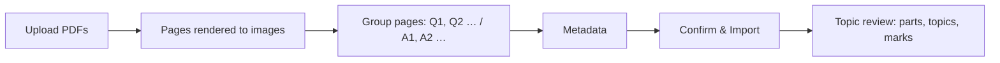

# Manual import

The admin turns one paper's PDF(s) into a paper by hand: the server renders every page to an image,
the admin groups pages into questions and answers, fills in the metadata and confirms. Used for
single papers and for booklet sections the [auto import](./auto-import.md) could not extract.

**Code:** `app/routes/ingest.py` (manual routes), `app/services/ingest.py`,
`app/pdf/image_processing.py`, `app/ai/filename_extractor.py`,
`frontend/src/features/import/` (`ManualImport.jsx`, `UploadDropZone.jsx`, `PageGrid.jsx`,
`PageThumbnail.jsx`, `Lightbox.jsx`, `MetadataSidebar.jsx`, `importMetadata.js`,
`manualHandoff.js`, `TopicReview.jsx`)
**Related:** [auto-import.md](./auto-import.md), [ai-labelling.md](./ai-labelling.md),
[manage-papers.md](./manage-papers.md), [users-and-premium.md](./users-and-premium.md),
[DATA_MODEL.md](../DATA_MODEL.md)

## Flow

`/admin/import/manual`, one page whose steps are states:

1. **Upload** — drop or pick one or more PDFs (non-PDF files are ignored). They are converted one
   after another ("Uploading PDF 2 of 3…") and their pages joined in upload order.
2. **Group** — a grid of page thumbnails; the admin groups pages into questions and answers and
   checks the metadata sidebar.
3. **Confirm & Import** — creates the paper.
4. **Topic review** — Claude splits each question into parts and suggests topics and marks; the
   admin corrects and saves ([ai-labelling.md](./ai-labelling.md)). There is no separate marks step.

## Rules

- Admin-only.
- Upload size is capped at 100 MB per request by the web server.
- Every page is rendered at 300 dpi, kept content-only (no margin), downscaled to at most **1760 px**
  wide (never upscaled) and stored as WebP. See
  [DATA_MODEL.md](../DATA_MODEL.md) for the image standards.
- Rendered pages sit in temporary storage (`tmp/`, expired by the bucket after 2 days) until the
  import is confirmed; preview links last 2 hours.
- Metadata is suggested from the **first** PDF's filename by Claude (filename only, no cover read);
  see [ai-labelling.md](./ai-labelling.md).
- Imported papers are **premium by default**; untick Premium to make it free
  ([users-and-premium.md](./users-and-premium.md)).
- The stream and level must belong to the same school level, otherwise confirm is refused.

## Grouping pages

- Thumbnails at A4 aspect, up to 5 per row, labelled `Q1, Q2, …` in page order.
- **Merge with prev** on a thumbnail (or in the lightbox) joins the page to the question before it;
  later labels renumber. Toggling it again splits them.
- **Q/A divider:** hover the gap before a page and click **÷**. That page and everything after it
  are answers, labelled `A1, A2, …` and merged the same way. One divider; **×** removes it. The first
  answer page cannot merge into the last question.
- **Answers pair with questions by position:** `A1` goes to `Q1`, `A2` to `Q2`, and so on. Extra
  answer groups become questions with answer pages only.
- **+ Append PDF** (button, or drop PDFs on the grid) adds more pages at the end.
- Clicking a thumbnail opens a lightbox: ← / → step through pages, Esc closes.

## Metadata sidebar

- Subject, stream, level (shown with its school level, e.g. "Secondary Sec 4"), school, exam type
  (all from the reference data), year, paper number (text: "1", "2", "a", …) and **Premium**.
- School is a plain dropdown: a new school must first be added in
  [reference data](./reference-data.md).
- Shows the number of questions and answer sets.
- **Confirm & Import →** is enabled once every field is filled. **Cancel Import** (asks first)
  discards the pages.

## Confirm

- Creates the paper, its questions in order (`Q1` = question 1), and each question's question and
  answer pages. Each question starts with one blank part; topics and marks come at the topic review.
- Images are copied to permanent storage before the database commit and the temporary copies removed
  after it. If anything fails nothing is kept and the import can be retried.
- Pending answer-only papers from auto import are re-matched against the new paper
  ([qa-pairing.md](./qa-pairing.md)).
- Manual imports record no provenance ([manage-papers.md](./manage-papers.md#provenance)).

## Topic review and cancelling

- **Save** in the topic review finishes the import and resets the wizard.
- **Cancel import** at this step (asks first) **deletes the paper** and its images.
- Later changes go through [Manage Papers](./manage-papers.md).

## Resuming and hand-off

- The wizard's state (step, pages, grouping, metadata, created paper) is kept in the browser tab's
  session storage, so a reload resumes it, and `/admin/import` opens Manual import while one is in
  progress.
- **Handle manually** on an auto-import review page cuts a page range from that job's booklet,
  renders it as above, pre-fills the metadata from the job (no new Claude call) and opens this wizard
  at the grouping step. It **replaces** any manual import in progress in that tab.
