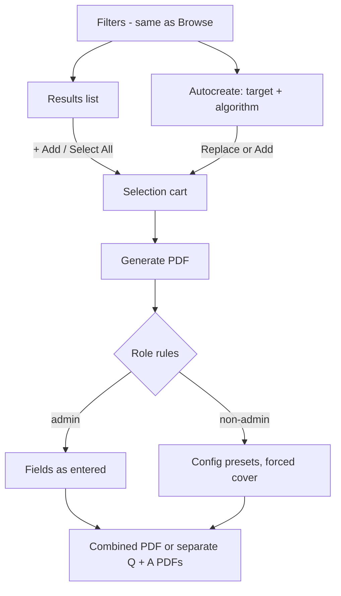

# Paper Generation

Signed-in users build a custom paper at `/generate` — picking questions by hand or auto-selecting
them to a marks or question-count target — and download it as PDF (question paper, answer key, or
both). Admins control every cover/header/footer field; everyone else gets the admin presets.

**Code:** `app/routes/generate.py`, `app/services/generate.py`, `app/services/premium.py`,
`app/services/question_query.py`, `frontend/src/pages/GeneratePage.jsx`,
`frontend/src/components/generate/`, `frontend/src/utils/pdfFilename.js`
**Related:** [browse.md](./browse.md), [generation-config.md](./generation-config.md),
[pdf-rendering.md](./pdf-rendering.md), [users-and-premium.md](./users-and-premium.md)

## Flow

1. Filter questions with the Browse filter suite ([browse.md](./browse.md)); results show as
   selectable cards with marks and **+ Add / ✓ Added**.
2. Build the **cart** by hand, with **Select All**, or with **Autocreate**.
3. Set the cover fields allowed for your role, choose the download mode, press **Generate PDF**.

## Building the selection

- **Cart:** de-duplicated list showing school / year / Q-number and marks, a running **total marks**,
  a warning when any question has no marks, per-item remove and **Clear**. Generate is enabled once
  the cart is non-empty.
- **Select All** adds up to the first **50** questions matching the filters; premium questions the
  user can't open are skipped (and counted in the notice). When more than 50 match, the button reads
  "Select All (first 50)" and a warning says the limit was hit.
- **Autocreate** — "Select by" **Number of questions** (default) or **Marks**, a target (> 0), mode
  **Replace selection** (default) or **Add to selection**, and algorithm **Random** (default) or
  **In-order**:
  - Replace: the result becomes the cart.
  - Add: asks only for the remainder (target − cart marks, or target − cart size) and excludes
    questions already in the cart. If the cart already meets the target, nothing is requested.
  - The result notice shows the server's warning (no matches, too few, inexact total) or a success
    summary. Autocreate never errors on an empty result — it returns nothing plus a warning.
- **Premium:** the autocreate pool excludes premium papers outside the user's school levels. Locked
  cards show a subscribe link instead of **+ Add**, so they can't enter the cart.

### Selection algorithms

The pool is every question matching the filters (same meaning as Browse), minus excluded and
unaffordable premium questions, in question-id order. A question's marks are the sum of its parts.
Known gap: the Generate page does not send the **Tags** filter to Autocreate, so autocreate ignores
it (the results list and Select All honour it).

| Target | Random | In-order |
|---|---|---|
| **Marks** | Gets as close as possible to the target, preferring an exact hit; may overshoot slightly if that is closer. Different paper each time. | Takes questions from the top of the list, stopping at the first one that would exceed the target. Never overshoots; always the same result. |
| **Count** | N questions at random. | First N questions. |

- Marks targets ignore questions with no marks (or zero) — which is why the AI puts an unattributed
  question total on the first part ([ai-labelling.md](./ai-labelling.md)). Count targets include them.
- Random marks selection is a repeated shuffled greedy fill (200–2000 attempts, scaling with pool
  size), stopping early on an exact match; ties between equally good papers are broken at random.
- A count above the pool size returns the whole pool, with a "Could not select N" warning.

## Cover, header and footer controls

| Field | Admin | Normal / premium user |
|---|---|---|
| Cover page | **Include cover page** checkbox (on by default) | always included |
| Title | configured titles + **Custom…** free text | must pick a configured title (first is default); dropdown disabled when none exist |
| Subtitle 1 / 2 | free text | free text (placeholder hints from config) |
| Cover letter body | rich-text editor, pre-filled from config | config preset |
| Additional instructions | rich-text editor, pre-filled from config | config preset |
| Header | rich-text editor, pre-filled from config | config preset |
| Footer | rich-text editor, pre-filled from config | config preset |

- Admin edits apply to that generation only; they never change the config
  ([generation-config.md](./generation-config.md)).
- The rich-text editor supports only paragraphs with **bold / italic / underline / link**.
- Server-side rules (a hand-crafted request can't bypass them):
  - Non-admin: cover forced on; body, instructions, header and footer replaced by the presets; an
    unknown title is rejected; an empty title falls back to the first configured title; with no
    titles configured the cover is untitled.
  - Admin: an omitted header falls back to the preset (so a client that never loaded the config still
    gets the branding); an explicitly cleared header prints none.
- If the config fails to load, the fields are left out and the server presets apply.
- The cover's marks box is filled server-side with the selection's total marks.

## Output

- **Download as:** **1 combined PDF** (default — question paper, then answer key) or **Separate
  question & answer PDFs** (two parallel requests, two downloads).
- Questions are numbered 1..N in cart order. An answer keeps its question's number; questions with
  no answer pages are skipped in the answer key. Layout rules: [pdf-rendering.md](./pdf-rendering.md).
- Filenames: `Pillora_<Title>_<Type>.pdf`, Type = `Ques and Ans` / `Questions` / `Answers`. Title is
  the cover title with `\ / : * ? " < > |` removed; blank falls back to `Topical Worksheets`.
- A progress bar estimates progress while the server renders (no real progress reporting).
- Each successful generation request increments the user's **papers generated** count shown on User
  Management (separate mode counts two). Failed renders don't count.

## Rules

- `/generate` requires sign-in; anonymous users can only browse.
- **Premium enforcement:** generating a PDF containing any premium question outside the user's school
  levels is refused outright; the page also blocks it before sending, naming the school level(s)
  needed. Admins are unrestricted.
- At least one question is required.
