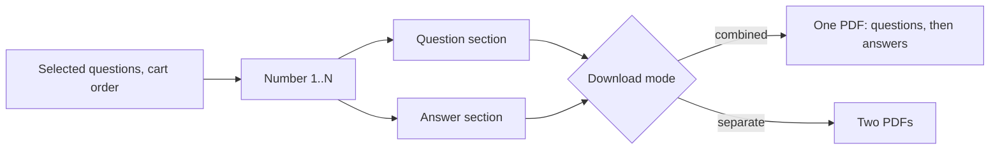

# PDF Rendering

How a resolved question selection becomes a PDF: page geometry, how question images are packed and
split across pages, the branded page chrome, the cover page, and the rich text they carry.
**Read this before changing anything that affects generated-PDF appearance**, and verify the change
visually ([TESTING.md](../TESTING.md)).

**Code:** `app/pdf/layout_engine.py`, `app/pdf/rich_text.py`, `app/pdf/image_processing.py`,
`app/pdf/assets/`, `app/routes/generate.py`, `app/pdf/sample_data.py`, `scripts/generate_sample_pdf.py`
**Related:** [paper-generation.md](./paper-generation.md) (who calls it, role rules),
[generation-config.md](./generation-config.md) (preset text), [DATA_MODEL.md](../DATA_MODEL.md)
(stored image sizes)

## Sections

A generated PDF holds one or two **sections**: the **question paper** and/or the **answer key**.

- Questions are numbered **1..N in selection order**; both sections use the same numbers.
- The answer section skips questions with no answer pages, but their numbers stay reserved so the
  remaining answers still match the question paper.
- In a combined PDF each section starts on a fresh page and keeps its own layout rules and page
  numbering; the answer section is omitted entirely when no selected question has answers.
- With a cover, each section opens with its own cover page.

## Page geometry

- **A4 portrait**, laid out at 300 DPI (2480 × 3508 px). Stored page images are content-only
  (≤ 1760 px wide, no margins); all margins and numbering are added here.
- **Content band:** between the header rule (~21 mm from the top) and footer rule (~21 mm from the
  bottom), inset ~5 mm from each. All question/answer images live in this band.
- **Left gutter:** ~30 mm (360 px). The question number is drawn in it, bold, right-aligned just left
  of the image and slightly below its top edge.

| | Question paper | Answer key |
|---|---|---|
| Image width | every image scaled to **1760 px (~149 mm)**, so all questions share one width | **native size** (≤ 1760 px) |
| Horizontal position | centred (30 mm margin each side) | flush to the 30 mm left margin |
| Gap between two images on the same page | **5 mm** — between questions and between pages of one question | **~8.5 mm** between questions; **none** between pages of one answer |
| Source credit line above each question | yes | no |
| Additional instructions | first content page | never |

- **Source credit:** a small grey line above each question,
  `[School/Year/ExamType/PaperNo/Q{original number}]`, e.g.
  `[Bendemeer Secondary School/2024/Prelim/2/Q6]`. It uses the question's number in its source
  paper, not its new number.
- An image taller than the content band is scaled down to fit it (aspect preserved).

## Packing

Greedy, in order, one running cursor down the content band:

1. A question **starts on the current page** if its credit line, its **first** page image and the
   gap above it fit in the remaining space; otherwise it starts on a new page.
2. Its remaining page images **flow**: each goes on the current page if it fits (with the gap),
   else on the next page. A multi-page question is never pushed whole to a fresh page just because
   it won't all fit.
3. Gaps are dropped at the top of a new page.
4. Short consecutive questions therefore share a page.
5. On the first content page the additional-instructions band is reserved first, sized to the text
   **as wrapped**, so long instructions push the first question down by exactly their height.

## Page chrome

Drawn on every page, including covers:

- **Purple rules** (`#776687`) at the top and bottom of the content band.
- **Logo** top-left, its visible bottom edge sitting just on the header rule. Optional: a missing or
  unreadable logo file just omits it.
- **Header** (branding): right-aligned on the header rule, in a column from just right of the logo
  to the right margin — long lines wrap rather than hit the logo. Multi-line headers stack
  **upward** so the last line always sits on the rule, never entering the content band. A blank
  header draws nothing.
- **Footer:** flush-left under the footer rule, in a column that stops short of the page number.
- **`Page {n}`** bottom-right, on the same baseline as the footer's first line. Numbering restarts at
  1 for each section; the cover is page 1.
- Header and footer are identical on both sections.

## Cover page

The section's first page; content starts on the next page. A section with a cover but no content is
the cover alone.

- Logo centred near the top.
- **Title** (bold, centred) with a suffix: `{title} - Question Paper` / `{title} - Answer Key`, or the
  bare suffix when untitled. The suffix is the **only** heading difference between the two covers.
- **Subtitle 1** and **Subtitle 2** below, centred, verbatim; each omitted when empty.
- **Marks box** top-right: `______ / {total}`, the total being the sum of all selected questions'
  marks (questions without marks count 0).
- **Letter body** (rich text, centred ~127 mm column) — **question-paper cover only**; the answer
  key's cover has none.
- Standard chrome.

## Rich text

The cover body, header, additional instructions and footer are all rich text, authored in one editor
(see [generation-config.md](./generation-config.md)).

- Supported: paragraphs, line breaks, **bold**, *italic*, underline, links. Everything else is
  stripped with its text kept; all text is escaped, so input can't break the PDF.
- Links render **blue, underlined and clickable**. Only `http(s)` and `mailto` targets are kept; a
  bare `www.` link gets `https://`; any other link is dropped (its text stays).
- An empty paragraph renders as a blank line.
- A **cleared field** (the editor's empty paragraph) counts as blank: it draws nothing and reserves
  no space.
- **Plain text** (no tags) is also accepted: blank lines separate paragraphs, single newlines become
  line breaks, and bare web addresses are auto-linked.
- Text wraps to its column; the space reserved during packing is exactly what is drawn.

## Verifying changes

The layout can be rendered with synthetic pages and no database, storage or network, then rasterised
to PNGs for inspection. Any change affecting PDF appearance must be checked this way — workflow in
[TESTING.md](../TESTING.md).
