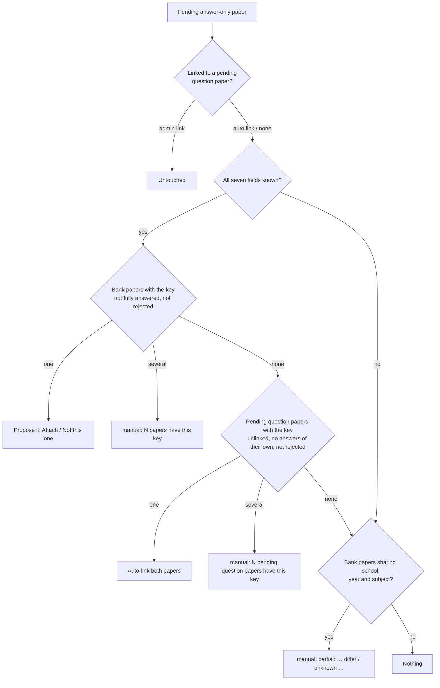

# Question/answer pairing

Gets a paper's answers onto its questions when they arrive in a separate booklet: an answer booklet
uploaded on its own, or answers for a paper already in the bank. Admin only; any admin may act on any
job. The job lifecycle around it (upload, worker, review queue, review page, confirm/skip) is in
[auto-import.md](./auto-import.md); the rationale is in [ADR 0002](../adr/0002-qa-booklet-pairing.md).

**Code:** `app/services/ingest_matching.py`, `app/services/match_candidates.py`,
`app/services/answer_mapping.py`, `app/services/answer_coverage.py`, `app/services/ingest_papers.py`,
`app/services/ingest_confirm.py`, `app/routes/ingest.py`, `frontend/src/features/import/`
(`PairingBlock.jsx`, `MatchDialog.jsx`, `AnswerMappingTable.jsx`, `pairing.js`, `answerMapping.js`,
`answerCoverage.js`, `ReviewQueuePage.jsx`, `reviewQueueText.js`, `SchoolCombobox.jsx`)
**Related:** [auto-import.md](./auto-import.md), [ingestion-pipeline.md](./ingestion-pipeline.md),
[ai-labelling.md](./ai-labelling.md), [manage-papers.md](./manage-papers.md),
[DATA_MODEL.md](../DATA_MODEL.md)

## Terms

- **Question paper:** a proposed paper with a question section (with or without its own answers).
- **Answer-only paper:** a proposed paper built from an answer section with no question section. Each
  numbered answer becomes an entry with answer boxes and no question boxes.
- **Bank paper:** a confirmed paper in the question bank.
- **Pending paper:** a proposed paper of a job under review that is not yet decided. Decisions:
  question paper → `confirmed` or `skipped`; answer-only paper → `attached` or `skipped`.
- **Link:** two pending papers (one of each role) paired so that confirming the question paper brings
  the answers in. **Proposal:** a bank paper suggested for an answer-only paper.

## Answer-only papers

**Code:** `ingestion/pipeline/proposal.py`, `app/services/ingest_confirm.py`

- The pipeline marks each proposed paper's role. A booklet's question section with no answer section
  raises a warning (paper and job level), so question-only booklets are flagged.
- On the review page an answer-only paper lists "Answer N (k rectangles)", shows "These are answers
  only…", and has the [Pairing block](#the-pairing-block-and-match-this-paper) and **Skip** instead of
  the metadata sidebar and **Confirm**.
- An answer-only paper is never confirmed as a paper. It is attached to a bank paper, linked to a
  pending question paper, or skipped.
- A paper with no questions at all can only be skipped.

## Paper details and the seven-field key

**Code:** `app/services/ingest_papers.py`

- Each proposed paper has one record holding its role, its details, where the details came from
  (`cover`, `filename` for old jobs, `admin`), its status, its link or proposal, and the bank paper it
  became or was attached to ([DATA_MODEL.md](../DATA_MODEL.md)). The job's proposal and review
  outcome stay authoritative; the record mirrors them in the same transaction and is what matching
  queries.
- Details are read per paper from its own cover ([ai-labelling.md](./ai-labelling.md)). A re-run
  refreshes them only while the paper is pending and the admin has not edited them.
- **Seven-field key:** school, year, level, subject, exam type, stream, paper number.
- **Paper number** is compared trimmed and case-folded only: `"2A"` = `" 2a "`, but ≠ `"02A"`.
- A school read from the cover that matches no school is kept and shown (in amber, "not in the
  list") but counts as blank until the admin picks a school or types a new one.
- Editing a pending paper's details (review sidebar, or the popup's tick box) re-runs
  [automatic matching](#automatic-matching) for it. Only while the job is `review_ready`.

### New schools

**Code:** `app/services/ingest_papers.py`, `frontend/src/features/import/SchoolCombobox.jsx`

- The school field (review sidebar and popup) is a type-to-search combobox ending with **Use
  "<typed>" as a new school**. Subject, stream, level and exam type accept existing entries only.
- A typed name equal to an existing school (trimmed, any case) selects that school.
- Nothing is added to the reference list until a **question paper is confirmed**, so a skipped job or
  a typo leaves nothing behind. Queue cards show it as "<name> (new)".
- **Confirming** a paper with a new school finds the school by name (another admin may have created
  it meanwhile) or creates it, and gives it to every other pending paper carrying that name, in the
  confirm's transaction. Confirm needs a school, picked or new.
- **Matching:** two papers have the same school if their schools are equal, or both are new with the
  same name (trimmed, case-folded). A new school counts as known. A bank paper always has a real
  school, so a new-school paper only matches pending papers.
- **Attaching** to a bank paper creates nothing: the bank paper's school is kept.

## Answers are all or none

**Code:** `app/services/answer_coverage.py`, `frontend/src/features/import/answerCoverage.js`

A paper should have answers on **every** question or on **none**. Anything in between is warned
about, never blocked, except where noted.

- **Coverage** is `none`, `partial` or `all`. A paper with no questions is `none`.
  - Pending paper: a question is answered when it has an answer box in the job's current proposal
    (the admin's edit, else the worker's). Editing answer boxes changes coverage.
  - Bank paper: a question is answered when it has an answer page.
- **Bank paper with coverage `all`:** never proposed, never a partial hint, greyed out in the popup
  as "Already has answers", and attaching to it is refused.
- **Bank paper with coverage `partial`:** a normal candidate, shown as "Only 8 of 12 questions have
  answers"; attaching asks append or replace.
- **Pending question paper with any answers of its own** (`partial` or `all`): cannot take another
  booklet's answers. Automatic matching never links it, pairing by hand is refused, the popup greys it
  out as "Already has answers", and it gets no **Match** button. Removing its answer boxes makes it a
  target again.
- **Partly answered question paper:** the review queue card and the review page say "Q5–Q7 have no
  answers"; the review page adds "Add them with the answer-box editor, or confirm anyway." above an
  enabled **Confirm paper**.
- **Linked pair:** judged as it will be confirmed (the questions the linked answers land on, by the
  pair's [mapping](#the-answer-mapping-table)); warns when the result is partial. A question paper with
  no answers at all is not warned about; it needs a partner instead.

## Automatic matching

**Code:** `app/services/ingest_matching.py`

Matching runs for every pending answer-only paper, and from the question side for every pending
question paper. The outcome is one of: a **proposal** (one bank paper), an **auto link** (one pending
question paper), **manual** (ambiguous or partial, with a note), or nothing.

- **Eligible pending partners:** in another `review_ready` job, or in the paper's **own** job (a
  booklet whose papers the pipeline did not pair), whatever that job's status.
- **Question side:** a pending, unlinked question paper with all seven fields known and **no answers
  of its own** looks for pending answer-only papers with its key. One → that answer paper is matched
  from its side (a single bank match still wins over the link). Several → the question paper and all
  of them become `manual` ("N pending answer papers have this key"). A question paper never matches a
  bank paper (that would be a duplicate).
- **Partial hints** never apply to a new school (no bank paper has it).
- **Admin links** are never touched. **Auto links** are recomputed from scratch each time, so a detail
  edit that breaks the key drops them; a freed partner is re-matched at once.
- **Rejected pairs** are skipped by every rule ([Rejecting a match](#rejecting-a-match)).
- **Settling** a paper (confirm, attach, skip) clears its proposal.
- `manual` leaves the paper unpaired; the Pairing block offers **Match this paper…**.

**When it runs:**

- At the end of the worker's `report` stage, in the same transaction as the proposal: every paper of
  the job, which also links the job's question papers to older jobs' (or its own) answer papers.
- When a pending paper's details are edited.
- After **Unmatch** (both papers), **Not this one**, and skipping or attaching a linked paper (its partner).
- On every new bank paper (auto-import confirm or manual import): pending answer-only papers in
  `review_ready` jobs sharing its school, year and subject are re-matched, so the new paper becomes a
  ready-to-attach proposal. This never fails the confirm.

## Rejecting a match

**Code:** `app/services/ingest_matching.py`, `app/services/ingest_papers.py`

Turning down one wrong pair rejects only that pair. Automatic matching never proposes or links it
again; both papers stay free to match anything else. Nothing lifts a rejection, not even a detail
edit; the admin can still pair it by hand (rejected pairs are listed in the popup).

- **Unmatch** (either side of a link, automatic or by hand): breaks the link on both papers, rejects
  the pair, and re-matches both, so either may at once be linked to or proposed something else.
- **Not this one** (an answer-only paper with a proposed bank paper): rejects that bank paper and
  re-matches the paper, which may propose another, auto-link a pending question paper, or find
  nothing.
- **Pairing by hand** with a paper that is already paired elsewhere releases the old link **without**
  rejecting it, so automatic matching may propose that pair again later.
- The review page shows the paper's new state in place of the old link or proposal.

## The Pairing block and "Match this paper"

**Code:** `frontend/src/features/import/PairingBlock.jsx`, `MatchDialog.jsx`, `pairing.js`,
`app/services/match_candidates.py`, `app/services/ingest_papers.py`

A paper **needs a partner** when it is pending, has questions, and is either answer-only or a
question paper with coverage `none`.

### The Pairing block

On the review page, above the metadata sidebar of a question paper and in place of it on an
answer-only paper, on every paper that needs a partner or has a link or proposal:

| State | Shown | Actions |
|---|---|---|
| No partner | "No match found" / "N possible matches" (exact candidates for the paper's current details) | **Match this paper…** |
| Linked to a pending paper | "Paired with <file> (<key>)" ("this file" for the same booklet), the partner's details, "matched automatically" or "matched by an admin" | **Check answers…**, **Change match…**, **Unmatch** |
| Answer-only paper with a proposed bank paper | "Answers match <paper>" | **Attach…**, **Change match…**, **Not this one** |

- **Check answers…** opens the [answer mapping table](#the-answer-mapping-table); **Save** stores the
  edited mapping on the pair.
- **Attach…** opens the mapping table for the proposed paper; **Attach answers** attaches with that
  mapping, asking append or replace (default append) only if the bank paper is partly answered.
- **Change match…** opens the popup.
- After an attach the block shows which questions got answers and which answer numbers were not
  attached; **Continue** moves on.

### The popup

Opened by **Match this paper…**, **Change match…**, or a queue card's **Match** button.

- **Fields:** subject, stream, level, school, exam type, year, paper number, pre-filled from the
  paper. Pickers are type-to-search over existing entries; school is the
  [new-school combobox](#new-schools). Clearing a field means "any".
- **Search** re-runs as the fields change:
  - only filled fields are compared, each **exactly** (paper number trimmed and case-folded; no fuzzy
    matching);
  - **Exact matches** (every filled field agrees, up to 50) are listed; when there are none, **Best
    matches**: the top 10 by number of agreeing fields, each differing field highlighted ("paper no.
    2A ≠ 2"). A booklet agreeing on nothing is left out.
- **Sources:**
  - pending papers of the other role in `review_ready` jobs or the paper's own job (own job first,
    then newest), excluding the paper itself and its current partner;
  - for an answer-only paper only, bank papers.
- **Each row:** where it is ("In the bank (paper 7)", "Pending in <file> (<key>)", "Same file
  (<key>)"), its details in words, its first question beside this paper's first answer (or the other
  way round), "This will unpair it from <file>" if already paired, and the coverage note ("Only 8 of
  12 questions have answers" or, greyed out with no action, "Already has answers").
- **Pair** (pending) or **Attach** (bank) moves to the [answer mapping table](#the-answer-mapping-table);
  nothing is saved yet. Its **Pair** button links the two papers and stores the mapping; its **Attach
  answers** button attaches with the mapping. **Back** returns to the list.
- **Also update this paper's details** (ticked by default, shown only while a pairable pending booklet
  is listed): saves the fields on the paper together with the pair. Untick it when fields were only
  cleared to widen the search. It never applies to an attach (an answer paper's details are not kept).
- Any unsaved review-page edit is saved first, because the server crops from the saved proposal.

### Pairing by hand

- Pairs an answer-only paper with a pending question paper, from either side, across jobs or within
  one job.
- **Refused** when: the papers are of the same role, the same paper, or either is decided; the other
  job is not under review; this job is not `review_ready`; or the question paper has answers of its
  own.
- The link is marked "matched by an admin" and is never changed by automatic matching.
- Any earlier link of either paper is released (not rejected) and its mapping discarded.
- Nothing is attached yet: the answers come in when the question paper is
  [confirmed](#confirming-a-linked-pair).

### From the review queue

**Code:** `frontend/src/features/import/ReviewQueuePage.jsx`, `reviewQueueText.js`

- Each paper line on a [Review queue](./auto-import.md) card that needs a partner and is **not
  linked** has a **Match** button opening the same popup without opening the job. A linked paper's
  match is changed or undone on the review page.
- Pre-filled from the card's details, with the cover's unresolved school name.
- The queue has no page images, so only the candidates' thumbnails show; the mapping table loads its
  own.
- After a pair or attach the popup closes and the queue refreshes (the card shows the new state, or
  leaves once every paper is decided).
- Card match states: answer-only "Linked to a question paper", "Matching paper found", "Needs
  matching — several candidates", "Not matched to a question paper"; question paper "Answers linked
  from another upload".
- On Auto import, the **All jobs** list's **Unmatched answers** filter shows jobs with a pending
  answer-only paper that is not linked.

## The answer mapping table

**Code:** `frontend/src/features/import/AnswerMappingTable.jsx`, `answerMapping.js`,
`app/services/answer_mapping.py`

Decides which answers go onto which questions when answers come from **another** booklet. Answers
inside one booklet are fixed with the answer-box editor ([auto-import.md](./auto-import.md)).

- **Shown** between choosing a booklet in the popup and saving, from **Check answers…** on a link,
  and from **Attach…** on a proposal. Either side of a pair may open it.
- **A mapping** sends each answer (by its label as written, trimmed: `"1"`, `"3a"`) to a question or
  to **Not placed**. An answer the mapping does not name goes onto the question with its number.
- **Rows:** each question with a thumbnail, beside the answers going onto it (each with a thumbnail
  and a picker); questions with answers of their own say so; unplaced answers are listed last. Rows
  start by number, or from the pair's stored mapping.
- **Shift all answers by N** re-places every answer by number + N (a Section B restarting at 1),
  discarding row edits. A non-numeric label only matches the same label, unshifted.
- **Warnings**, live and never blocking: "Q11–Q12 would get no answers" (no answers placed and none
  of its own) and "Answer 13 has no question".
- **Stored** on the pair (on the answer paper) for a link; none means by number, which an automatic
  link uses until someone edits it. An attach's mapping is used once, not stored.
- **Changing the match discards it:** a new pair, Unmatch, skipping either paper, attaching the
  answer paper to a bank paper, or an auto link dropped by a detail edit. An auto link re-made with the same partner keeps it.

## Attaching answers to an existing paper

**Code:** `app/services/ingest_confirm.py`

Puts an answer-only paper's answers onto a bank paper and settles the answer paper as `attached`.

- **Refused when:** the paper is not answer-only; the job is not `review_ready`; the paper is already
  decided; or every question of the bank paper already has answers.
- **Placing:** by the mapping where it names an answer, else by question number (`1`, `"1"`, `" 01 "`
  all mean 1). Several answers on one question are merged. Answers landing on no question (a
  non-numeric number with no mapping, a number the paper lacks, or mapped to **Not placed**) are not
  attached; they are reported back and recorded. If nothing lands, the attach is refused and nothing
  changes.
- **Mode, per question:** `replace` removes the question's existing answer pages; `append` adds after
  them. Not chosen: replace when the question has no answer pages, else append. The UI asks only for a
  partly answered bank paper (default append).
- New answer pages are cropped like a confirm, carry provenance ([manage-papers.md](./manage-papers.md)),
  and never collide with existing page orders.
- **Releases its link:** a linked answer paper attached elsewhere (via **Change match…**) frees its
  question paper, which is matched afresh and no longer expects those answers on confirm.
- **One transaction:** the page rows, the job's outcome, the paper record and a `paper_attached` event.
  On failure nothing changes and temporary crops are removed; replaced images are deleted after the
  commit. Attaching counts as a decision for settling the job.

## Confirming a linked pair

**Code:** `app/services/ingest_confirm.py`

Confirming a question paper linked to a pending answer-only paper (another job's or the same job's)
also attaches those answers and settles both.

- Both jobs are locked in a fixed order (one lock for a same-job pair).
- **The answers are used only if** the answer job is still `review_ready` and the answer paper is
  still pending, undecided and linked back. Otherwise the confirm goes ahead without them and logs a
  warning.
- Answer boxes are cropped from the **answer job's** PDF (its edited proposal if any), placed by the
  pair's mapping (else by number), added after the question paper's own answer pages, with provenance
  from that PDF.
- Unplaced answers are reported. If none is placed, the answer paper stays pending and linked.
- **One transaction:** question paper `confirmed`, answer paper `attached` to the new paper, both
  jobs' outcomes and events (`paper_confirmed` noting the answer job; `paper_attached` noting the
  question job). Each job whose papers are now all decided becomes `confirmed` and its files are
  dropped; a same-job pair is judged after both outcomes are recorded.
- The review page shows "Attached answers for questions … from <file> (<key>)" and any unplaced
  numbers above the topic review.

## Known gaps

- **Detaching answers after confirm** is not supported; fix a wrong attach in
  [Manage Papers](./manage-papers.md).
- **Duplicate-paper protection (#81)** waits on a live-DB check. The bank has no uniqueness on the
  seven-field key, so duplicates are possible and matching treats them as "several". Planned:
  normalise paper numbers on write ("P1", "Paper 1", "I" → "1"; letters kept), add a unique index,
  and turn a duplicate confirm into "this paper already exists — attach to it instead?".
