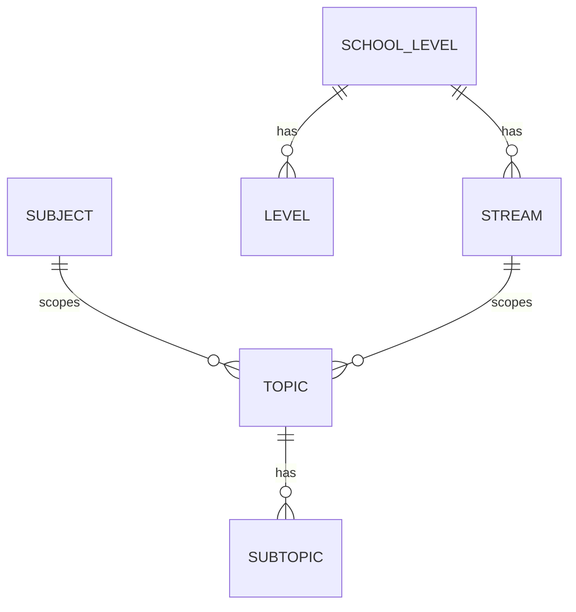

# Reference Data

The admin-curated lookup lists every paper and question is classified against: school levels,
subjects, streams, levels, schools, exam types, topics/subtopics and tags. Anyone can read them;
only admins change them. Cover titles are also admin lists but belong to
[generation-config.md](./generation-config.md).

**Code:** `app/routes/reference.py`, `app/schemas/reference.py`, `scripts/import_topics.py`,
`frontend/src/pages/admin/ReferencePage.jsx`, `frontend/src/features/reference/`
**Related:** [users-and-premium.md](./users-and-premium.md), [manage-papers.md](./manage-papers.md),
[browse.md](./browse.md), [DATA_MODEL.md](../DATA_MODEL.md)

## Entities

| Entity | Examples | Rules |
|---|---|---|
| School level | Primary, Secondary | Name unique. Each one is also a **premium plan** — see [users-and-premium.md](./users-and-premium.md). |
| Subject | E Math, A Math, Science | Name unique. |
| Stream | Foundation, Standard, G1–G3 | Belongs to one school level. Name unique across all school levels. |
| Level | 1–6 (Primary), 1–4 (Secondary) | Belongs to one school level; name unique within it. Shown as "Secondary 1". Ordered by a sort order that drives every level list. |
| School | — | Name unique. |
| Exam type | WA1–3, End-of-Year, Prelim, PSLE, O-Level | Name unique. |
| Topic | "Algebra" | Belongs to a **(subject, stream)** pair; has a topic number. Name and number each unique within the pair. |
| Subtopic | — | Belongs to a topic; name unique within it. |
| Tag | — | Flat, global label attached to questions by admins. Name unique. |

- A paper's stream and level must be in the **same school level**; paper saves refuse a mismatch
  because the paywall reads the level's school level.
- Topics are per (subject, stream): G2 Math and G3 Math each define their own list, and "Algebra"
  can exist in both. Consequences:
  - Browse/Generate only offer topics once both subject and stream are chosen.
  - Changing a paper's subject or stream clears its questions' topic labels (marks and parts
    survive) — see [manage-papers.md](./manage-papers.md).
- Topic numbers show as a `T{n}:` prefix everywhere except the Topics editor, which has its own
  number column.
- Default school levels, subjects, streams, levels and exam types are seeded by the initial database
  migration.

## Deleting

| What | When it's in use |
|---|---|
| School level, subject, stream, level, school, exam type | **Refused** ("still in use") while any paper, stream, level or topic references it. A pending auto-import proposal does not block it; that proposal's field is just cleared. |
| School level (when allowed) | Also removes every user's premium grant for it. |
| Topic (single delete) | Refused while any question part is labelled with it. |
| Topics/subtopics removed via **Save all** in the Topics editor | Allowed after a warning; labels are stripped from questions, questions kept. |
| Subtopic (single delete) | Allowed; labels are stripped from questions. |
| Tag | Allowed; removed from every question carrying it. |

## Admin UI

`/admin/reference` — tabs: School Levels, Subjects, Schools, Exam Types, Streams, Levels,
Topics & Subtopics, Tags.

- Simple tabs (school levels, subjects, schools, exam types, tags): list, add, rename, delete with a
  confirm dialog. Errors (duplicate name, still in use) show in the modal or dialog.
- Streams and Levels pick a school level. Levels are **reordered by drag and drop**, which rewrites
  their sort order.

### Topics & Subtopics editor

1. Pick a **subject and a stream**; the editor loads that pair's topics as a grid (Topic No. / Topic
   Name / Sub-Topic).
2. Edit cells, add/remove topics and subtopics, or **paste from Google Sheets**:
   - A multi-cell paste anywhere in the table **replaces the whole grid**.
   - Columns: Topic No., Topic Name, Sub-Topic. A header row is skipped. A blank Topic Name (merged
     cells) continues the current topic; a repeated topic name joins the same topic; a missing
     number takes the previous number + 1. Duplicate subtopics within a topic are dropped.
   - Pasted topics keep their identity by **topic number**, and subtopics by **name** within the
     topic, so existing question labels survive a paste of the same list.
3. **Save all** writes the grid as the complete list for that (subject, stream): rows are updated,
   created, and anything missing is deleted.
   - Before saving: every topic needs a name and a number ≥ 1; blank subtopic rows are dropped.
   - Server rejects duplicate topic numbers and duplicate names (case-insensitive) within the save.
   - If anything will be deleted, a warning lists the topics and subtopics first; confirming strips
     their labels from questions (the questions are kept). Not undoable.
4. **Revert** discards unsaved edits.

### Bulk topic import script

`scripts/import_topics.py <file> <subject> <stream>` loads topics from a text file (a number line,
then the topic name, then one subtopic per line, repeated). A topic whose name already exists in that
(subject, stream) has its subtopics **replaced**, which strips those subtopic labels from questions.
The Topics editor's paste covers the same need from the UI.
